<div align="center">
  
  <br />
  <p>
    <strong>From noisy application events to trustworthy, testable service analytics.</strong>
  </p>
  <p>
    
    
    
    
    
    
    
    
    
  </p>
  <p>
    <em>Portfolio engineering project · Analytics Engineering first · Data Engineering second</em>
  </p>
</div>

---

## Executive summary

**PulseStream** is a local-first distributed event analytics and reliability platform. It accepts versioned HTTP request-completion events from simulated microservices, transports them through a partitioned event log, processes them with Python consumers, preserves delivery evidence in ClickHouse, and transforms that evidence into tested analytical models with dbt.

The platform exposes service-level traffic, 5xx error rates, latency percentiles, processing delay, consumer lag, retries, duplicate deliveries, and dead-letter activity through FastAPI and Grafana.

The central engineering question is not simply *“Can the system process events?”* It is:

> **Can we account for every accepted source record, explain how it was handled, recover from controlled failures, and prove that the analytical metrics remain correct?**

PulseStream deliberately uses **at-least-once delivery**. Duplicate processing is expected at certain failure boundaries. The project preserves raw evidence, distinguishes physical sink retries from logical duplicate events, and applies explicit deduplication rules before producing canonical analytics.

> [!IMPORTANT]
> This repository is an engineering MVP and a reproducible local experiment—not a claim of production high availability or exactly-once delivery. The throughput figures in this README are **benchmark targets**, not measured achievements. Actual results belong in the benchmark report after tests have been executed.

---

## Contents

- [Project at a glance](#project-at-a-glance)
- [Research framing](#research-framing)
- [System architecture](#system-architecture)
- [Event lifecycle](#event-lifecycle)
- [Event contract](#event-contract)
- [Analytical architecture and lineage](#analytical-architecture-and-lineage)
- [Data model and table grains](#data-model-and-table-grains)
- [Metric contracts](#metric-contracts)
- [Reliability and delivery semantics](#reliability-and-delivery-semantics)
- [Failure-injection experiments](#failure-injection-experiments)
- [Technology decisions](#technology-decisions)
- [Repository structure](#repository-structure)
- [Local setup](#local-setup)
- [Using the API](#using-the-api)
- [Generating events](#generating-events)
- [Dashboards and observability](#dashboards-and-observability)
- [dbt workflow and data quality](#dbt-workflow-and-data-quality)
- [Testing and reconciliation](#testing-and-reconciliation)
- [Benchmark methodology](#benchmark-methodology)
- [Operational runbook](#operational-runbook)
- [Security and privacy](#security-and-privacy)
- [Limitations and scope boundaries](#limitations-and-scope-boundaries)
- [Implementation roadmap](#implementation-roadmap)
- [Documentation map](#documentation-map)
- [Interview discussion guide](#interview-discussion-guide)
- [References](#references)

---

## Project at a glance

| Dimension | Design |
|---|---|
| Primary user | Backend, platform, or reliability engineer |
| Portfolio alignment | **Analytics Engineer first**, Data Engineer second |
| Event domain | Synthetic HTTP request-completion telemetry |
| Event grain | One logical completed HTTP request per `event_id` |
| Broker | Redpanda, Kafka-compatible API |
| Default topic partitions | 3 main-topic partitions and 3 DLQ partitions |
| Processing model | Python consumer group with manual offset commits |
| Delivery guarantee | At-least-once, with explicit duplicate handling |
| Raw and analytical storage | ClickHouse `MergeTree` tables and dbt models |
| Metadata storage | PostgreSQL service registry and stream settings |
| Transformations | dbt Core + `dbt-clickhouse` |
| Window grain | One service × one UTC minute |
| Late-event policy | 15-minute automatic correction horizon; older events require backfill |
| Duplicate policy | Seven-day logical event-ID deduplication guarantee |
| Observability | Prometheus + Grafana |
| Local runtime | Docker Compose |

### What a reviewer can explore

| Capability | What to look for |
|---|---|
| Ingestion | Versioned contract, API validation, broker acknowledgement |
| Streaming | Partition key, consumer group, manual commits, lag |
| Data engineering | Raw delivery evidence, DLQ archive, bounded retries |
| Analytics engineering | dbt staging/intermediate/fact/mart layers and metric contracts |
| Data quality | Uniqueness, accepted values, reconciliation and late-event rules |
| Reliability | Consumer restart, sink outage, retry behavior and recovery |
| Performance | Reproducible load profiles, p95 visibility delay and time-to-catch-up |

---

## Research framing

PulseStream is structured as a small systems-engineering investigation. It defines observable questions, controlled inputs, measurable outcomes, and known validity limits. It is **not** presented as peer-reviewed research or as a production benchmark suite.

### Questions under investigation

| ID | Research question | Evidence collected |
|---|---|---|
| RQ-01 | Can accepted broker records be accounted for across valid processing, duplicate delivery, and DLQ routing? | Run manifests, broker coordinates, ClickHouse raw rows, dbt facts, reconciliation output |
| RQ-02 | How do consumer lag and end-to-end visibility delay respond to load bursts? | Producer rate, per-partition lag, consumer throughput, p50/p95/p99 visibility delay |
| RQ-03 | What happens to offset progress when ClickHouse becomes unavailable? | Retry metrics, committed offsets, lag growth, post-recovery reconciliation |
| RQ-04 | Can event-time reporting be corrected for recent late arrivals without appending duplicate minute aggregates? | Before/after mart queries, dbt build results and fixture assertions |
| RQ-05 | How much analytical distortion would occur if physical sink retries and logical duplicate event IDs were treated as the same phenomenon? | Separate duplicate audit models and controlled duplicate fixtures |

### Experimental hypotheses

- **H1 — Offset safety:** A source offset must not advance before the valid event is durably written to ClickHouse or the invalid event is acknowledged by the DLQ broker.
- **H2 — At-least-once consequence:** A crash after a successful sink write but before offset commit can cause a repeated physical sink write; broker coordinates must make this detectable.
- **H3 — Analytical idempotency:** Reprocessing the same broker record or publishing the same logical `event_id` again must not inflate canonical request metrics within the documented policies.
- **H4 — Backpressure visibility:** If event production continues while the consumer or sink is unavailable, lag and freshness signals should expose the backlog rather than hide it.

### Measurement protocol

Each controlled run should record a random seed, run identifier, generated IDs, expected acceptance/rejection categories, duplicate injections, event-time offsets, service/status distribution, environment details, and start/end timestamps. The expected values must be computed independently from the production dbt model logic.

---

## System architecture

### Logical architecture

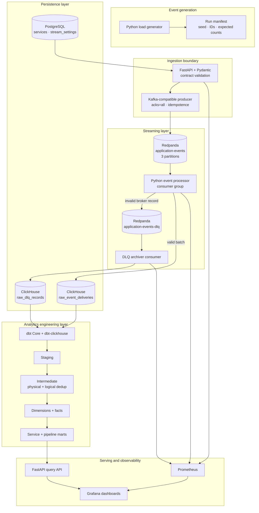

### Component responsibilities

| Component | Responsibility | Explicit boundary |
|---|---|---|
| FastAPI `api` | Validate external event contract, publish to Redpanda, expose read/health endpoints | Does not run long-lived consumer loops or own analytical metric SQL |
| Load generator | Produce controlled synthetic workloads and run manifests | Does not decide analytical correctness |
| Event consumer | Validate broker records, persist valid batches, route invalid records, commit offsets safely | Does not define business-facing metrics |
| DLQ archiver | Persist DLQ topic records to ClickHouse | Does not auto-replay or silently repair bad payloads |
| ClickHouse | Store raw deliveries, DLQ archive and analytical models | Does not serve as service-registry source of truth |
| PostgreSQL | Store registered services and stream settings | Does not store high-volume request events |
| dbt runner | Build/test documented SQL models on a serialized micro-batch cadence | Does not consume Redpanda messages |
| Grafana | Visualize analytics and operational telemetry | Does not become the source of truth for metric calculations |

### Local topology

The default local topology uses one Redpanda node, one ClickHouse instance, one PostgreSQL instance, one API process, one event consumer, one DLQ archiver, one serialized analytics runner, Prometheus, and Grafana. The broker replication factor is one in the local demo.

> [!NOTE]
> Three partitions demonstrate partition assignment and consumer-group parallelism. A single Redpanda node with replication factor one does **not** demonstrate broker high availability or node-failure tolerance.

---

## Event lifecycle

### Successful event path

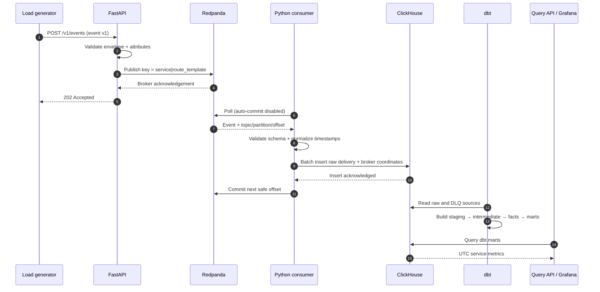

### Invalid broker-record path

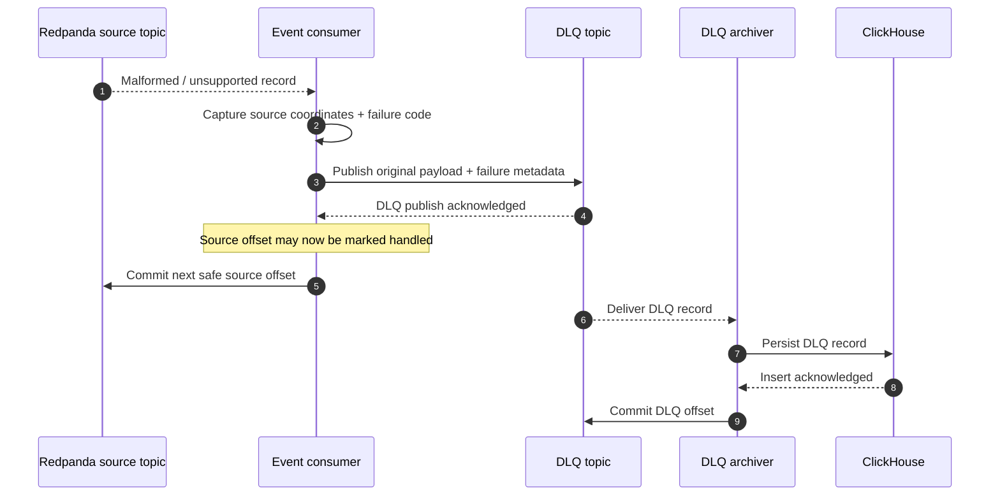

### ClickHouse outage and recovery

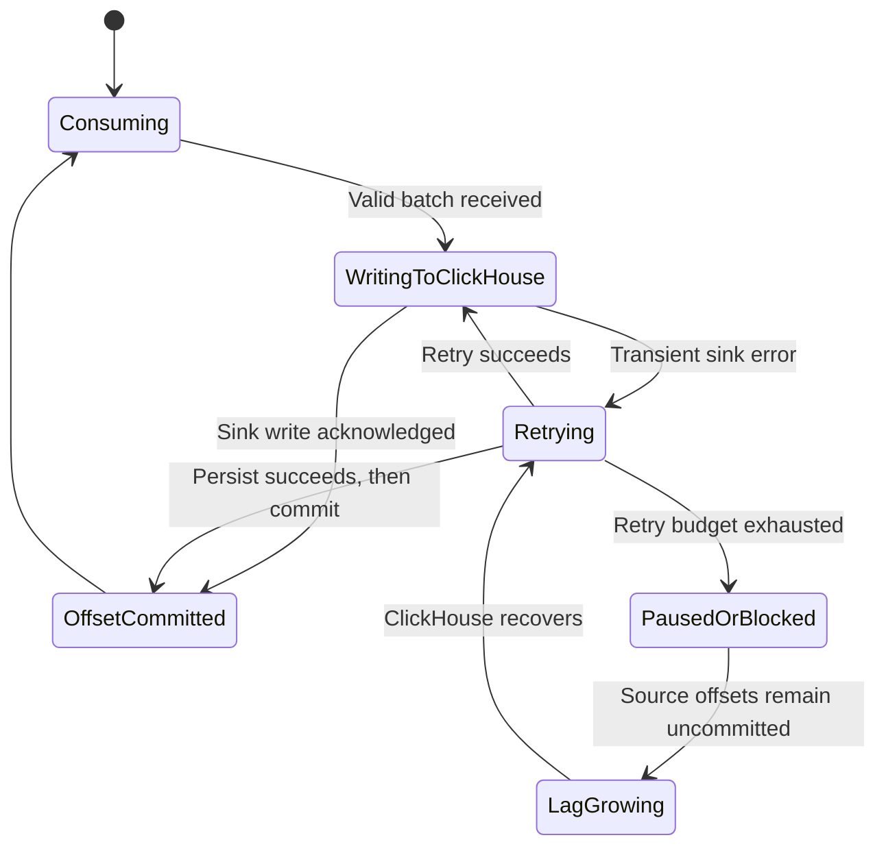

**Offset rule:** valid source offsets are committed only after the corresponding ClickHouse write succeeds. Invalid source offsets are committed only after DLQ publication is acknowledged. The consumer tracks contiguous handled offsets per partition; it must not commit past an earlier unhandled record.

---

## Event contract

### Canonical HTTP completion event — schema v1

```json
{
  "event_id": "8a9b2d50-4fc6-4f6b-8dbe-741bbf7d4e1f",
  "schema_version": 1,
  "event_time": "2026-11-11T10:15:22.384Z",
  "producer": "load-generator",
  "service": "order-service",
  "event_type": "http.request.completed",
  "attributes": {
    "method": "POST",
    "route_template": "/orders",
    "status_code": 201,
    "duration_ms": 42.7,
    "trace_id": "4bf92f3577b34da6a3ce929d0e0e4736"
  }
}
```

The timestamp and identifiers are illustrative. Stored timestamps are normalized to UTC with millisecond precision.

| Field | Type | Required | Contract |
|---|---|---:|---|
| `event_id` | UUID | Yes | Stable logical identifier, retained across duplicate/replay attempts |
| `schema_version` | Positive integer | Yes | MVP supports version `1`; unknown versions are not silently coerced |
| `event_time` | ISO-8601 timestamp | Yes | Must include a timezone; normalized to UTC |
| `producer` | String | Yes | Non-empty, bounded length |
| `service` | String | Yes | Lowercase slug; registered or explicitly allowed for demo |
| `event_type` | String | Yes | `http.request.completed` |
| `attributes.method` | String | Yes | Uppercase HTTP method from an allow-list |
| `attributes.route_template` | String | Yes | Templated route only; no full URL/query string/raw user identifier |
| `attributes.status_code` | Integer | Yes | 100–599 |
| `attributes.duration_ms` | Float | Yes | Greater than or equal to zero |
| `attributes.trace_id` | String or null | No | Optional correlation identifier; never a credential |

### Platform timestamps

The platform adds timestamps outside the producer envelope:

| Field | Meaning |
|---|---|
| `broker_timestamp` | Broker record timestamp when available |
| `processed_at` | Consumer processing/sink-write time |
| `failed_at` | Time a broker record is classified and sent to DLQ |
| `archived_at` | Time the DLQ record is persisted in ClickHouse |

`processing_delay_ms = processed_at - event_time`. Negative values are retained because they can reveal clock skew; they are not silently clamped to zero.

### Where validation happens

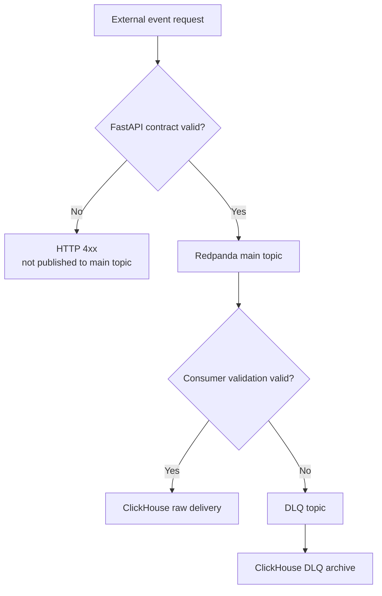

API-level validation failures are not DLQ records because they never entered the broker. Consumer-side invalid records are DLQ events. The two counts must remain separate.

---

## Analytical architecture and lineage

PulseStream separates delivery evidence from canonical analytical events. The dbt project is the authority for analytical deduplication, dimensional grain and metric calculation; Grafana and the query API consume the published marts.

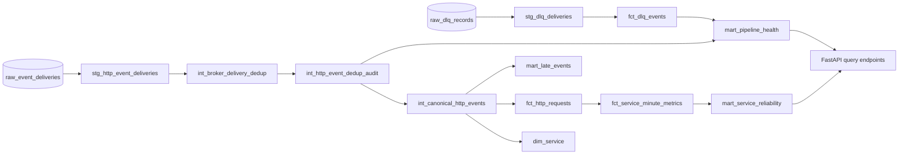

### dbt model catalogue

| Layer | Model | Materialization | Declared grain / purpose |
|---|---|---|---|
| Source | `src_raw_event_deliveries` | Source declaration | Physical raw event delivery rows |
| Source | `src_raw_dlq_records` | Source declaration | Physical DLQ archive rows |
| Staging | `stg_http_event_deliveries` | View | Typed, renamed, normalized valid delivery rows |
| Staging | `stg_dlq_deliveries` | View | Typed and normalized DLQ rows |
| Intermediate | `int_broker_delivery_dedup` | View | One row per source topic/partition/offset |
| Intermediate | `int_http_event_dedup_audit` | View | Event-ID ranking and duplicate indicators |
| Intermediate | `int_canonical_http_events` | View | One canonical event per event ID within the horizon |
| Dimension | `dim_service` | View/table | One row per canonical service name |
| Fact | `fct_http_requests` | View/incremental table | One canonical HTTP completion per `event_id` |
| Fact | `fct_service_minute_metrics` | Incremental table | One service × UTC minute |
| Fact | `fct_dlq_events` | View/table | One logical DLQ record per DLQ broker coordinate |
| Mart | `mart_service_reliability` | View | Service traffic, error and latency metrics |
| Mart | `mart_pipeline_health` | View | DLQ, duplicate, processing-delay and pipeline summaries |
| Mart | `mart_late_events` | View | Events outside the automatic correction horizon requiring backfill |

### Data lineage and modeling principles

1. Raw deliveries are append-oriented evidence and are not overwritten to “fix” events.
2. Physical retries are deduplicated using `(topic, partition_id, offset_id)`.
3. Distinct broker records with the same `event_id` are logical duplicate deliveries.
4. A single canonical event per `event_id` is used for request analytics within the seven-day guarantee.
5. Service-level minute facts are built from canonical events, grouped by `(service_name, window_start)`.
6. DLQ events remain separately modeled and never silently disappear into request facts.
7. ClickHouse logical uniqueness is enforced through dbt tests and reconciliation—not assumed to be a PostgreSQL-style enforced constraint.

---

## Data model and table grains

### Logical entity relationship overview

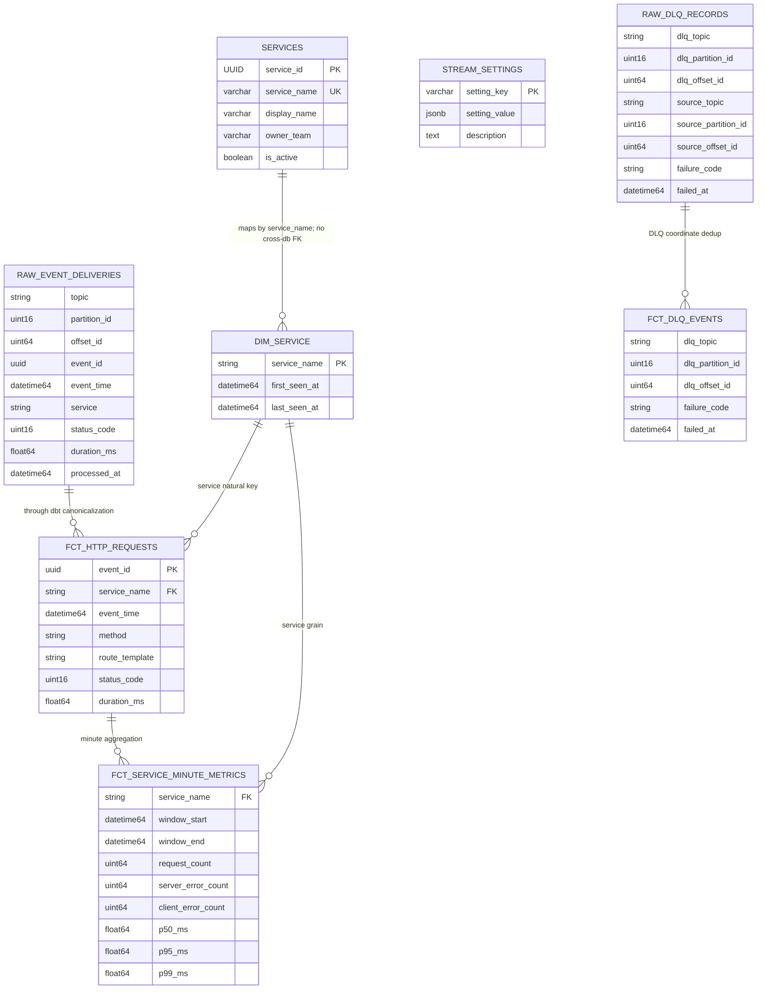

> [!NOTE]
> `PK` and `FK` labels on ClickHouse/dbt entities communicate **logical keys and tested relationships**. ClickHouse does not enforce these as ordinary relational constraints. PostgreSQL physically enforces the `services` and `stream_settings` keys. There is no cross-database foreign key; `service_name` is the conformed natural key.

### Explicit grains

| Model | Grain | Logical key | Primary use |
|---|---|---|---|
| `services` | One row per registered service | `service_id`; unique `service_name` | Metadata and ownership |
| `stream_settings` | One row per setting | `setting_key` | Runtime configuration metadata |
| `raw_event_deliveries` | One sink insert row per processing attempt of a broker record | Source `(topic, partition_id, offset_id)` plus physical insert history | Immutable-ish audit evidence |
| `raw_dlq_records` | One sink insert attempt per DLQ record | DLQ `(topic, partition, offset)` | Invalid-record evidence |
| `dim_service` | One row per canonical service | `service_name` | Service dimension |
| `fct_http_requests` | One canonical HTTP completion event | `event_id` within dedup horizon | Request-level analytics |
| `fct_service_minute_metrics` | One service × UTC minute | `(service_name, window_start)` | Minute-level metrics |
| `fct_dlq_events` | One logical DLQ record | `(dlq_topic, dlq_partition_id, dlq_offset_id)` | Dead-letter analytics |

---

## Metric contracts

All service metrics use **event time** and fixed one-minute UTC windows. The interval is half-open: `[window_start, window_end)`. For example, `10:15:22.384Z` belongs to `[10:15:00Z, 10:16:00Z)`.

| Metric | Definition | Important interpretation |
|---|---|---|
| `request_count` | Count of canonical events in a service-minute group | Not raw deliveries; duplicates are excluded |
| `request_rate_per_sec` | `request_count / 60.0` | Average rate for the complete minute, not instantaneous RPS |
| `server_error_count` | Count where status is 500–599 | Server errors only |
| `server_error_rate` | `server_error_count / request_count` | `NULL` when denominator is zero |
| `client_error_count` | Count where status is 400–499 | Kept distinct from 5xx |
| `success_or_redirect_count` | Count where status is 100–399 | Completes mutually exclusive status buckets |
| `latency_p50_ms` | `quantileTDigest(0.50)(duration_ms)` | Approximate t-digest percentile |
| `latency_p95_ms` | `quantileTDigest(0.95)(duration_ms)` | Approximate; label in API and dashboard |
| `latency_p99_ms` | `quantileTDigest(0.99)(duration_ms)` | Approximate; small samples may be unstable |
| `processing_delay_ms` | `processed_at - event_time` | Signed; negative values can indicate clock skew |
| `duplicate_delivery_count` | Non-canonical logical deliveries per event ID within horizon | Different broker coordinates, same `event_id` |
| `physical_sink_retry_duplicate_count` | Extra raw rows sharing the same source broker coordinates | Same broker record inserted more than once |
| `invalid_event_count` | Logical records archived from DLQ | Excludes API-level 4xx validation rejections |
| `consumer_lag` | High-watermark minus committed/processed offset using a consistent convention | Per-partition gauge, not an additive time-series counter |
| `last_successful_processing_at` | Last batch whose sink write succeeded and corresponding offsets were committed | Must not advance on failed writes |

### HTTP status classification

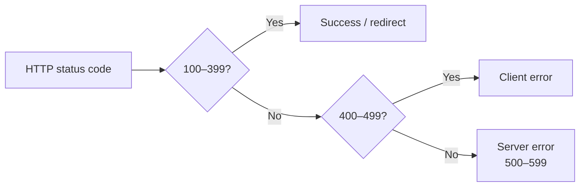

The core `server_error_rate` is strictly a 5xx ratio. Do not label a 4xx + 5xx combination as “server error rate.” In API-level ingestion, HTTP 4xx means the external event was rejected and never published; that is a separate operational metric.

---

## Reliability and delivery semantics

### Delivery guarantee

PulseStream provides **at-least-once** processing from Redpanda to ClickHouse. It does not promise exactly-once delivery across the broker and ClickHouse boundary.

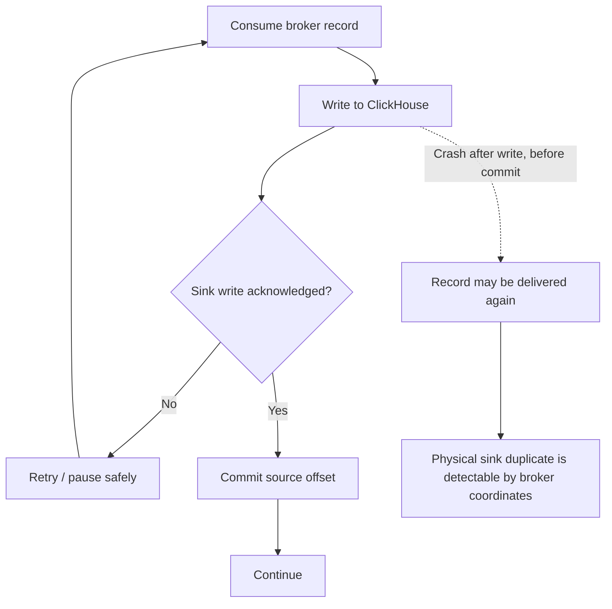

### Two duplicate classes—never collapse them

| Duplicate type | Identity | Cause | Analytics treatment |
|---|---|---|---|
| Physical sink retry duplicate | Same `(topic, partition_id, offset_id)` | Sink write succeeded, but process failed before offset commit; message is reprocessed | Deduplicate broker record in `int_broker_delivery_dedup` |
| Logical event duplicate | Same `event_id`, different broker coordinates | Same logical event submitted or published more than once | Preserve in duplicate audit; only one canonical event contributes to metrics within seven days |

### Retry and backpressure policy

- Transient ClickHouse failures use bounded exponential backoff with jitter.
- Batch sizes and retry budgets are capped.
- The consumer must not keep polling unbounded batches into memory while the sink is unavailable.
- After retry exhaustion, consumption is safely paused/blocked and source offsets remain uncommitted.
- Lag is expected to increase during an outage; the system must expose it.
- After ClickHouse recovers, uncommitted records are retried/re-consumed, persisted, committed, and reconciled.

### Event time versus processing time

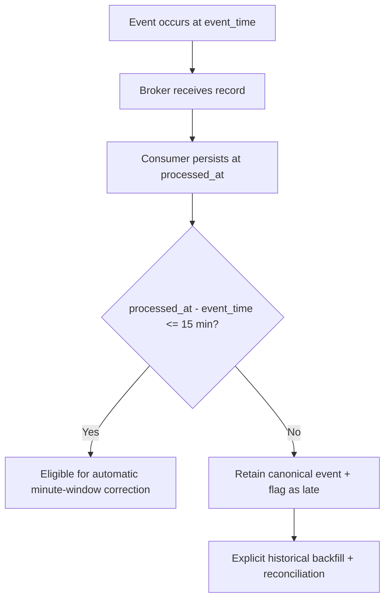

| Policy | Value | Meaning |
|---|---:|---|
| Window size | 1 minute | UTC wall-clock minute |
| Window alignment | UTC | `window_start` inclusive; `window_end` exclusive |
| Allowed lateness for automatic correction | 15 minutes | Recent late events can update recent minute aggregates |
| Older late events | Explicit backfill | Retained and flagged; not silently discarded |
| Logical duplicate guarantee | 7 days | Deduplication promise is bounded to this horizon |

The dbt runner executes serialized builds approximately every 60 seconds. It recomputes current and previous UTC date partitions for the minute fact. The model uses ClickHouse `insert_overwrite` with date partitioning where supported and tested; if adapter compatibility is unsuitable, a safe full-refresh strategy is preferred to append-only aggregates.

---

## Failure-injection experiments

Every failure scenario should have an injection command, an expected observable signal, a recovery action, and an evidence artifact.

| Experiment | Injection | Expected behavior | Evidence |
|---|---|---|---|
| Invalid external event | Send malformed/invalid body to API | HTTP 4xx; no main-topic publish | API test and broker count |
| Invalid broker record | Publish unsupported/malformed record directly to main topic | Consumer publishes to DLQ before source offset commit | DLQ topic and ClickHouse archive |
| Duplicate event ID | Publish same `event_id` at distinct broker coordinates | Raw audit retains both; canonical fact has one logical event within horizon | dbt duplicate audit and uniqueness test |
| Consumer interruption | Stop event consumer while load continues | Lag increases; no source offset progress from stopped worker | Lag by partition and offsets |
| Consumer recovery | Restart event consumer | Processing resumes; lag decreases; last-success advances | Consumer logs and reconciliation |
| ClickHouse outage | Stop ClickHouse while load continues | Bounded retries; source offsets are not committed before write | Retry metrics, lag and committed offsets |
| ClickHouse recovery | Restart ClickHouse | Consumer catches up and data reconciles | Recovery duration and reconciliation report |
| Burst load | Run 500 events/sec for a bounded interval | Lag may rise then return toward baseline | Lag curve and catch-up time |
| Late event inside horizon | Inject an event 10 minutes old | Affected minute aggregate corrects after refresh | Before/after mart query |
| Late event outside horizon | Inject an event 20 minutes old | Retained and flagged; explicit backfill needed | `mart_late_events` and backfill record |
| DLQ archiver interruption | Stop DLQ archiver / sink | DLQ topic lag grows; source DLQ record remains durable | DLQ group lag and archive reconciliation |

### Recovery invariant

For a bounded test interval with known broker coordinates:

```text
source_broker_records
  = valid_logical_deliveries
  + invalid_records_successfully_routed_to_dlq

valid_logical_deliveries
  = canonical_unique_events
  + duplicate_logical_deliveries
```

Repeated ClickHouse writes of the **same broker coordinate** are counted separately as physical sink retry duplicates. They must not be counted as new broker records or new logical events.

---

## Technology decisions

| Technology | Why it belongs | What it demonstrates | Known trade-off |
|---|---|---|---|
| Python 3.12+ | Shared implementation language | API, producer, consumers, utilities, tests | Runtime performance must be measured rather than assumed |
| FastAPI + Pydantic | Typed ingestion/query boundary | Validation, API contracts, health endpoints | API must not own long-running stream processing |
| Redpanda | Kafka-compatible partitioned log | Partitions, consumer groups, replay, lag | Single-node local topology is not highly available |
| `confluent-kafka` | Kafka-compatible Python client | Producer acknowledgement, manual commit, consumer semantics | Client/broker configuration needs explicit tests |
| ClickHouse | Columnar analytics store | High-volume event SQL and time-window aggregation | Not a relational OLTP metadata store |
| PostgreSQL | Relational metadata store | Service registry, uniqueness and configuration | No enforced cross-database FK to ClickHouse |
| dbt Core + `dbt-clickhouse` | Version-controlled analytics transformations | SQL layers, metric contracts, tests, docs | Adapter/server versions must be pinned and integration-tested |
| Prometheus | Operational metric collection | Counters, gauges, histograms and lag signals | Avoid high-cardinality labels |
| Grafana | Dashboard and exploration | Service analytics and pipeline health | Visualization is not the metric source of truth |
| pytest | Automated verification | Unit, contract, integration and recovery tests | Integration scenarios need a running local stack |
| Docker Compose | Reproducible local environment | One-command development stack | Host resources influence local results |

### Intentionally excluded from MVP

Kubernetes, Spark, Flink, Airflow, Redis, a complex React frontend, public cloud deployment, multi-broker high availability, an external schema registry, multi-tenancy, authentication/RBAC, notification integrations, and ML anomaly detection.

---

## Repository structure

The intended top-level structure follows the technical architecture. The implemented repository may evolve, but module ownership should remain explicit.

```text
pulsestream-event-analytics/
├── app/
│   ├── api/                  # FastAPI routes, dependencies and schemas
│   ├── contracts/            # Canonical event schema and validation
│   ├── producer/             # Kafka-compatible producer and load generator
│   ├── consumers/            # Event processor, DLQ archiver and handlers
│   ├── storage/              # ClickHouse and PostgreSQL persistence
│   ├── observability/        # Prometheus metrics and structured logging
│   ├── common/               # Time, retry and error utilities
│   └── config.py             # Typed environment configuration
├── dbt/
│   ├── models/
│   │   ├── staging/
│   │   ├── intermediate/
│   │   ├── dimensions/
│   │   ├── facts/
│   │   └── marts/
│   ├── tests/
│   ├── macros/
│   └── seeds/
├── infra/
│   ├── docker-compose.yml
│   ├── redpanda/
│   ├── clickhouse/
│   ├── postgres/
│   ├── prometheus/
│   └── grafana/
├── scripts/                  # Topic setup, invalid injection, replay, reconcile, benchmark
├── tests/
│   ├── unit/
│   ├── contract/
│   ├── integration/
│   └── resilience/
├── docs/
│   ├── architecture/
│   ├── contracts/
│   ├── analytics/
│   ├── operations/
│   ├── quality/
│   └── interview-guide.md
├── artifacts/
│   ├── runs/                 # Controlled run manifests
│   └── benchmarks/           # Reproducible measurement outputs
├── .env.example
├── pyproject.toml
├── Makefile
└── README.md
```

---

## Local setup

PulseStream is designed to run locally. A cloud account is not required for the MVP.

### Prerequisites

| Requirement | Recommended |
|---|---|
| OS | Windows 11 with Docker Desktop + WSL2, macOS, or Linux |
| Docker | Docker Engine/Desktop with Compose v2 |
| RAM | 16 GB minimum recommended; 32 GB more comfortable |
| CPU | 4 or more logical cores recommended |
| Disk | Reserve roughly 20–30 GB for images, volumes and local artifacts |
| Git | Recent Git installation |
| Python | 3.12+ for local development and tests |

Actual resource use depends on Docker limits, event volume, data retention, and whether all monitoring services are enabled.

### 1. Clone the repository

```bash
git clone https://github.com/<YOUR_GITHUB_USERNAME>/pulsestream-event-analytics.git
cd pulsestream-event-analytics
```

Replace `<YOUR_GITHUB_USERNAME>` with the GitHub account that owns the repository.

### 2. Create local environment configuration

**macOS / Linux / Git Bash:**

```bash
cp .env.example .env
```

**Windows PowerShell:**

```powershell
Copy-Item .env.example .env
```

Review `.env` before starting the stack. The `.env.example` file is the source of truth for the exact variable names and safe local defaults. Typical configuration groups include:

| Configuration group | Examples |
|---|---|
| Broker | Bootstrap server, main topic, DLQ topic, partition count, consumer groups |
| Producer | Acknowledgement policy, delivery timeout, maximum message size |
| Consumer | Batch size, poll interval, retry count and backoff bounds |
| ClickHouse | Host, HTTP/native ports, database and local credentials |
| PostgreSQL | Host, port, database, user and local credentials |
| Analytics | Deduplication horizon, allowed lateness, refresh interval and lookback |
| Monitoring | Grafana and Prometheus ports and local credentials |

Never commit `.env`. Do not use real credentials or production event payloads in this local demo.

### 3. Start the infrastructure and application

The implementation exposes the standard Makefile interface below. The equivalent `docker compose` commands can be used if preferred.

```bash
make up
```

Equivalent direct command:

```bash
docker compose -f infra/docker-compose.yml up -d --build
```

Check container health:

```bash
docker compose -f infra/docker-compose.yml ps
```

Inspect logs:

```bash
make logs
# or

docker compose -f infra/docker-compose.yml logs -f --tail=200
```

The startup workflow should initialize the local topics, ClickHouse raw tables, PostgreSQL metadata seed, and required application dependencies. Confirm readiness before generating traffic.

### 4. Verify health and open the interfaces

| Interface | Local URL | Purpose |
|---|---|---|
| FastAPI docs | <http://localhost:8000/docs> | Explore ingestion/query endpoints |
| API liveness | <http://localhost:8000/health/live> | Process liveness |
| API readiness | <http://localhost:8000/health/ready> | Required dependency readiness |
| Prometheus | <http://localhost:9090> | Inspect scraped operational metrics |
| Grafana | <http://localhost:3000> | Service and pipeline dashboards |
| ClickHouse HTTP | <http://localhost:8123> | Local analytical store endpoint |

Grafana credentials and any non-default ports are defined in `.env.example`. Do not assume default credentials in a shared environment.

### 5. Generate a first workload

```bash
docker compose -f infra/docker-compose.yml run --rm load-generator \
  --rate 100 \
  --duration 60 \
  --services user-service,order-service,payment-service \
  --server-error-rate 0.02
```

This is a 60-second illustrative workload at a target rate of 100 generated events per second, with a 2% configured 5xx probability. Actual publish rate is an observed value and must be reported from the run manifest/metrics.

If you prefer the Makefile wrapper:

```bash
make generate RATE=100 DURATION=60 SERVICES=3 SERVER_ERROR_RATE=0.02
```

### 6. Build analytical models

The analytics runner normally performs serialized refreshes at approximately 60-second intervals. To trigger a one-off build and tests:

```bash
make dbt-build
```

Or, where the analytics runner container is already running:

```bash
docker compose -f infra/docker-compose.yml exec analytics-runner \
  dbt build --select staging intermediate dimensions facts marts
```

The first successful run may take longer than the target refresh interval while schemas and models are created.

### 7. Run tests

Create a local virtual environment if you are running Python tooling on the host.

**Windows PowerShell:**

```powershell
py -3.12 -m venv .venv
.\.venv\Scripts\Activate.ps1
python -m pip install --upgrade pip
python -m pip install -e ".[dev]"
python -m pytest
```

**macOS / Linux:**

```bash
python3.12 -m venv .venv
source .venv/bin/activate
python -m pip install --upgrade pip
python -m pip install -e ".[dev]"
python -m pytest
```

Integration and resilience tests require the relevant local Compose services to be running. Unit and contract tests should remain runnable without a live broker/database wherever practical.

### 8. Stop the stack

```bash
make down
```

Equivalent direct command:

```bash
docker compose -f infra/docker-compose.yml down
```

> [!WARNING]
> `docker compose down -v` removes named volumes and permanently deletes the local Redpanda, ClickHouse, and PostgreSQL demo data. Use it only when you intentionally want a clean reset.

### Makefile command interface

| Command | Purpose |
|---|---|
| `make up` | Build and start local stack |
| `make down` | Stop stack without deleting volumes |
| `make logs` | Follow service logs |
| `make generate RATE=100 DURATION=60 SERVICES=3 SERVER_ERROR_RATE=0.02` | Run a controlled synthetic workload |
| `make dbt-build` | Run dbt build and tests |
| `make test` | Run the appropriate pytest suite |
| `make reconcile RUN_ID=<run-id>` | Reconcile a controlled run |
| `make benchmark PROFILE=baseline` | Execute a named workload profile |
| `make clean` | Remove generated local artifacts; should not delete volumes unless explicitly requested |

The Makefile is the operator-facing interface. If an implementation changes a target name or option, update this table and the related runbook at the same time.

---

## Using the API

The complete interactive contract is available at `/docs` after the API is ready.

### Endpoint catalogue

| Method | Endpoint | Purpose |
|---|---|---|
| `POST` | `/v1/events` | Publish one validated event |
| `POST` | `/v1/events/batch` | Publish a bounded batch |
| `GET` | `/v1/services` | List registered services |
| `GET` | `/v1/metrics/services` | Query service metrics by UTC time range and optional service |
| `GET` | `/v1/metrics/pipeline` | Query pipeline health summary |
| `GET` | `/health/live` | Process liveness |
| `GET` | `/health/ready` | Dependency readiness |
| `GET` | `/metrics` | Prometheus scrape endpoint |

### Publish a single event

```bash
curl -X POST "http://localhost:8000/v1/events" \
  -H "Content-Type: application/json" \
  -d '{
    "event_id": "8a9b2d50-4fc6-4f6b-8dbe-741bbf7d4e1f",
    "schema_version": 1,
    "event_time": "2026-11-11T10:15:22.384Z",
    "producer": "manual-demo",
    "service": "order-service",
    "event_type": "http.request.completed",
    "attributes": {
      "method": "POST",
      "route_template": "/orders",
      "status_code": 201,
      "duration_ms": 42.7,
      "trace_id": "4bf92f3577b34da6a3ce929d0e0e4736"
    }
  }'
```

A `202 Accepted` response means the broker acknowledged publication under the configured producer policy. It does **not** mean the event has already been persisted to ClickHouse or materialized in the dbt marts.

An invalid external payload should return a descriptive 4xx response and should not be published to `application-events`.

### Query service metrics

```bash
curl --get "http://localhost:8000/v1/metrics/services" \
  --data-urlencode "start=2026-11-11T10:00:00Z" \
  --data-urlencode "end=2026-11-11T11:00:00Z" \
  --data-urlencode "service=order-service" \
  --data-urlencode "granularity=1m"
```

The response uses UTC timestamps. `start` is inclusive, `end` is exclusive, and the MVP supports `1m` granularity. Ratios with a zero denominator are represented as `null`, not fabricated as zero.

### Query pipeline health

```bash
curl "http://localhost:8000/v1/metrics/pipeline"
```

The response should summarize available lag, retry, DLQ, duplicate, processing-delay and last-success indicators. Prometheus remains the source for high-resolution operational time series.

---

## Generating events

The workload generator is part of the experiment design, not just a demo convenience.

### Workload controls

| Control | Purpose |
|---|---|
| Target event rate | Approximate events generated per second |
| Service count/names | Distribute events across simulated services |
| 5xx probability | Control server-error ratio |
| 4xx probability | Independently control client-error ratio, if enabled |
| Duration distribution | Generate request durations and tail behavior |
| Run duration / total count | Bound the workload |
| Burst size and interval | Create short-lived traffic spikes |
| Duplicate injection | Re-publish a stable event ID at a different broker coordinate |
| Late-event offset | Create an event timestamp older than processing time |
| Random seed | Make controlled tests repeatable |

### Example service set

- `user-service`
- `order-service`
- `payment-service`
- `notification-service`

The default event type is `http.request.completed`. PulseStream intentionally does not mix order/payment business events into the MVP event contract.

---

## Dashboards and observability

The dashboards separate **service behavior** from **pipeline behavior**. This prevents a broker outage or a dbt delay from being mistaken for an application service error.

### Dashboard A — Service Analytics

| Panel | Interpretation |
|---|---|
| Request count / rate by service | Volume per UTC minute; rate is `request_count / 60` |
| 5xx server error rate | `server_error_count / request_count` |
| 4xx client error rate | Separate client-side failure view |
| p50 / p95 / p99 latency | Approximate t-digest percentiles in milliseconds |
| Service comparison | Compare services over a consistent time range |
| Minute-level trend | Identify service-specific changes over time |

### Dashboard B — Pipeline Reliability

| Panel | Interpretation |
|---|---|
| Ingestion requests by result | Accepted versus API-rejected traffic |
| Producer publish duration | Broker publishing latency |
| Consumer throughput / batch duration | Processing rate and batch behavior |
| Consumer lag by partition | Backlog using a consistent offset convention |
| Retry and ClickHouse write errors | Sink pressure and recovery behavior |
| DLQ records by failure code | Invalid broker records by reason |
| Processing-delay p50 / p95 | Event-time to processing-time delay |
| Last successful processing | Time of last persisted-and-committed batch |
| dbt build duration / last success | Analytics freshness and transformation health |

### Key application metrics

| Metric | Type | Cardinality guidance |
|---|---|---|
| `pulsestream_ingest_requests_total` | Counter | `result`, `endpoint` |
| `pulsestream_events_published_total` | Counter | `service`, `topic` |
| `pulsestream_publish_duration_seconds` | Histogram | `topic` |
| `pulsestream_consumer_records_total` | Counter | `consumer`, `outcome` |
| `pulsestream_consumer_batch_size` | Histogram | `consumer` |
| `pulsestream_consumer_batch_duration_seconds` | Histogram | `consumer` |
| `pulsestream_consumer_lag` | Gauge | `consumer_group`, `topic`, `partition` |
| `pulsestream_retries_total` | Counter | `component`, `dependency`, `reason` |
| `pulsestream_clickhouse_write_errors_total` | Counter | `consumer` |
| `pulsestream_dlq_published_total` | Counter | `failure_code` |
| `pulsestream_last_successful_processing_timestamp_seconds` | Gauge | `consumer` |
| `pulsestream_analytics_build_duration_seconds` | Histogram | `result` |
| `pulsestream_analytics_build_last_success_timestamp_seconds` | Gauge | No labels |

> [!WARNING]
> Never use `event_id`, `trace_id`, raw URL, or other high-cardinality identifiers as Prometheus labels. Keep those identifiers in structured logs or analytical storage.

---

## dbt workflow and data quality

### Transformation cadence

The analytics runner executes serialized dbt builds approximately once per minute:

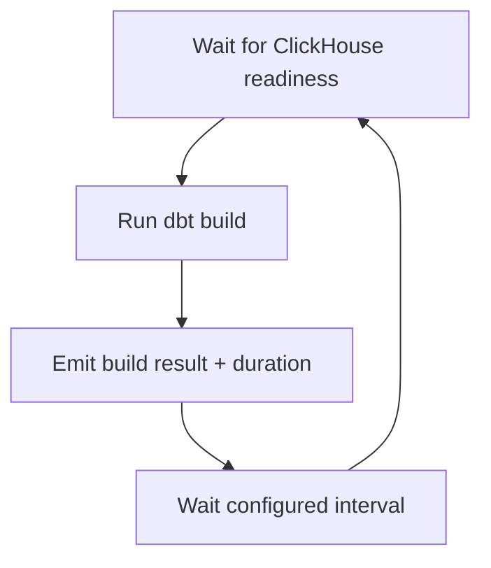

Builds must not overlap. The current and previous UTC date partitions are recomputed to support the 15-minute correction horizon. The minute fact should use a tested ClickHouse partition-overwrite strategy; if the pinned adapter/server combination cannot support the intended incremental behavior, use a safe full-refresh path for the MVP rather than append duplicate aggregates.

### Required quality checks

- Required canonical columns are non-null.
- Event type and schema version are accepted values.
- HTTP method and status-code domain are valid.
- `duration_ms` is non-negative.
- `event_id` is unique at the canonical fact grain within the deduplication scope.
- `dim_service.service_name` is unique.
- `(service_name, window_start)` is unique in the minute fact.
- Service fact keys map to `dim_service` using the natural key.
- `server_error_count <= request_count` and `client_error_count <= request_count`.
- Status buckets sum to request count.
- Minute aggregate counts reconcile to eligible canonical events.
- DLQ logical keys are unique after broker-coordinate deduplication.

### Reconciliation equations

For source records in a controlled completed offset range:

```text
source_broker_records
  = valid_logical_deliveries
  + invalid_records_successfully_routed_to_dlq

valid_logical_deliveries
  = canonical_unique_events
  + duplicate_logical_deliveries
```

Separately:

```text
physical_sink_retry_duplicates
  = extra raw rows sharing the same (topic, partition_id, offset_id)
```

For each eligible service-minute range:

```text
SUM(fct_service_minute_metrics.request_count)
  = COUNT(fct_http_requests eligible for automatic correction)
```

A reconciliation report must show expected count, actual count, difference, diagnostic status and representative IDs/coordinates for mismatches. A single green “passed” label is not sufficient evidence.

---

## Testing and reconciliation

### Test strategy

| Test layer | Tooling | Scope |
|---|---|---|
| Unit | pytest | Event validation, timestamp normalization, status classification, key construction, retry policy |
| Contract | pytest | v1 payloads, required/optional fields, unsupported versions |
| API integration | FastAPI TestClient + local broker where needed | 202 acknowledgement semantics, 4xx rejection, batch limits, health |
| Consumer integration | Redpanda + ClickHouse | Valid writes, DLQ, offsets, duplicate replay |
| dbt | dbt tests | Nullability, accepted values, uniqueness, model relationships, reconciliation |
| Resilience | pytest + Docker Compose controls | Consumer stop/restart, sink outage, DLQ failure, burst, late events |
| Performance | Load generator + system metrics | Throughput, visibility delay, lag, retry rate and resource usage |

### Deterministic correctness fixture

The fixture should include a known set such as:

- 10 canonical events for one service and one minute.
- 2 repeated logical event IDs published at different broker offsets.
- 1 malformed broker message.
- A controlled set of 2xx/3xx, 4xx and 5xx status codes.
- Known request durations for percentile assertions.
- One event delayed by 10 minutes (inside the correction horizon).
- One event delayed by 20 minutes (outside the automatic correction horizon).

Expected counts and quantiles must be calculated independently from the production model logic. Approximate t-digest percentiles are tested against exact fixture values within a documented tolerance.

### Run tests

```bash
make test
```

For a local Python environment, `python -m pytest` is also supported. Integration tests that exercise broker, ClickHouse, and restart semantics require the local stack.

---

## Benchmark methodology

### Initial workload profiles

These are planned test profiles, **not achieved throughput claims**.

| Profile | Target rate | Purpose | Status |
|---|---:|---|---|
| Baseline | 100 events/sec | Sustained normal-load behavior | To be measured |
| Elevated | 250 events/sec | Observe throughput and lag under higher load | To be measured |
| Burst | 500 events/sec | Observe temporary backpressure and catch-up | To be measured |
| Stretch | 1,000 events/sec | Optional hardware-dependent experiment | Not an acceptance requirement |

### Measurement definitions

| Measurement | Definition |
|---|---|
| Offered rate | Events attempted by the load generator per second |
| Accepted rate | Events for which the API confirms broker acknowledgement per second |
| Persisted rate | Valid logical deliveries durably written to ClickHouse per second, excluding duplicates as defined by the report |
| Consumer lag | Per-partition high watermark minus committed/processed offset using one consistent convention |
| Ingestion-to-query visibility delay | Time from event generation/publication boundary to first appearance in queryable analytical output; report exact measurement boundaries |
| Time-to-catch-up | Elapsed time from workload/outage end or sink recovery until lag returns to the declared baseline |
| Loss/reconciliation difference | Expected logical records minus accounted logical records, categorized by valid, duplicate and DLQ outcomes |

### Required environment metadata

Every benchmark report must contain CPU model/cores, RAM, disk, OS, Docker version, container limits, Redpanda partition and broker settings, ClickHouse engine/order key, producer count, consumer count, batch size, event size, run duration, service distribution, error/duplicate rates, and whether dbt/Grafana were active.

### Results table — populate only from executed runs

| Run ID | Profile | Offered events/sec | Accepted events/sec | Persisted events/sec | p95 visibility delay | Peak lag | Catch-up time | Reconciliation |
|---|---|---:|---:|---:|---:|---:|---:|---|
| _No verified benchmark run recorded yet_ | — | — | — | — | — | — | — | — |

Do not replace this row with invented values. Add a row only when the corresponding machine-readable run artifact and environment metadata have been saved under `artifacts/benchmarks/`.

---

## Operational runbook

The detailed runbook should live at [`docs/operations/runbook.md`](docs/operations/runbook.md). The quick operator actions are:

| Task | Action |
|---|---|
| Start stack | `make up` |
| Inspect status | `docker compose -f infra/docker-compose.yml ps` |
| Follow logs | `make logs` |
| Stop stack | `make down` |
| Stop consumer | `docker compose -f infra/docker-compose.yml stop event-consumer` |
| Restart consumer | `docker compose -f infra/docker-compose.yml start event-consumer` |
| Simulate ClickHouse outage | `docker compose -f infra/docker-compose.yml stop clickhouse` |
| Restore ClickHouse | `docker compose -f infra/docker-compose.yml start clickhouse` |
| Rebuild analytics | `make dbt-build` |
| Reconcile a run | `make reconcile RUN_ID=<run-id>` |

During a consumer or ClickHouse outage, continue a bounded workload only for the controlled experiment. Observe lag, retries and last-success metrics. After recovery, wait for processing and dbt refresh to catch up, then run reconciliation.

### DLQ replay policy

Replay is explicit and auditable. Select records by DLQ coordinates or run ID, correct or map the payload to a supported schema, preserve the original logical `event_id` when it represents the same event, publish with replay metadata, and reconcile the outcome. The MVP does not automatically replay every DLQ record.

---

## Security and privacy

- Use synthetic data only.
- Do not store tokens, secrets, cookies, authorization headers, request bodies, or personal data.
- Store route templates, never full paths containing user identifiers or query strings.
- Bound event payload size and string lengths.
- Sanitize DLQ error messages and avoid logging full sensitive payloads.
- Keep real `.env` files out of Git.
- Bind development ports locally unless a reviewer intentionally changes the setup.
- Use bounded-cardinality Prometheus labels.
- Do not expose database credentials through API responses or logs.

---

## Limitations and scope boundaries

A technically honest portfolio project makes its limits visible.

| Area | MVP limitation | Consequence |
|---|---|---|
| Broker topology | One local Redpanda node; replication factor one | No broker HA or node-failure tolerance |
| Processing guarantee | At-least-once | Duplicate processing can occur across sink-write/offset-commit failure boundary |
| Logical deduplication | Seven-day guarantee | Suppression beyond the horizon is not promised |
| Late events | 15-minute automatic correction horizon | Older events require explicit backfill and reconciliation |
| Percentiles | t-digest approximate | p50/p95/p99 are approximate, not exact |
| Analytics freshness | Serialized dbt refresh around every 60 seconds | Freshness depends on build duration and load |
| Cross-store relationships | No enforced PostgreSQL-to-ClickHouse FK | Relationship integrity is checked through application/dbt tests |
| Deployment | Local Docker Compose | No managed cloud or production HA claim |
| Security | Synthetic local demo; no public multi-user auth | Do not expose as a public ingestion service without hardening |

### Threats to measurement validity

- Local Docker resource contention can influence measured throughput and delay.
- A benchmark with Grafana/dbt disabled is not directly comparable with a run where they are active.
- Small samples can make tail percentiles unstable.
- Clock skew affects event-to-processing delay; retain signed values and record host time assumptions.
- A change in broker partitions, producer count, consumer count, event size or batch size changes the experiment conditions.
- A benchmark result is meaningful only with its run manifest and environment metadata.

---

## Implementation roadmap

| Phase | Deliverable | Exit evidence |
|---|---|---|
| 0 — Foundation | Repository, Docker Compose, configuration, logging, pytest baseline | Clean startup and basic health checks |
| 1 — Contract and ingestion | Event v1, generator, FastAPI, Redpanda topics | Valid publish and invalid API rejection tests |
| 2 — Processing and DLQ | Consumer group, ClickHouse raw writes, DLQ, retries and offset safety | DLQ, duplicate, restart and sink-outage tests |
| 3 — Analytics | dbt sources, staging, intermediate, dimensions, facts and marts | Metric fixtures, dedup and reconciliation tests |
| 4 — Serving and observability | Query API, Prometheus and Grafana dashboards | Dashboard panels show test traffic and pipeline health |
| 5 — Resilience proof | Failure simulations, run manifests, benchmarks, runbook and portfolio polish | PRD acceptance criteria pass or exceptions are evidenced |

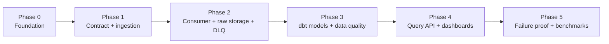

The sequence is dependency-driven, not a delivery-date commitment. Complete each phase's exit evidence before advancing to the next phase.

---

## Documentation map

| Document | What it should contain |
|---|---|
| [`docs/architecture/technical-architecture.md`](docs/architecture/technical-architecture.md) | Component topology, data flow, storage and operational contracts |
| [`docs/contracts/event-schema-v1.md`](docs/contracts/event-schema-v1.md) | Versioned event envelope and validation rules |
| [`docs/analytics/metric-catalog.md`](docs/analytics/metric-catalog.md) | Metric names, formulas, grains, filters and edge cases |
| [`docs/analytics/data-dictionary.md`](docs/analytics/data-dictionary.md) | Column types, nullability, business meaning and source lineage |
| [`docs/analytics/data-model.md`](docs/analytics/data-model.md) | ERD, dimensional grains and model lineage |
| [`docs/operations/runbook.md`](docs/operations/runbook.md) | Startup, health, recovery, replay, reconciliation and reset procedures |
| [`docs/operations/failure-scenarios.md`](docs/operations/failure-scenarios.md) | Failure injection steps and expected evidence |
| [`docs/quality/benchmark-report.md`](docs/quality/benchmark-report.md) | Environment, workload parameters, actual results and run IDs |
| [`docs/quality/reconciliation.md`](docs/quality/reconciliation.md) | Reconciliation equations, result interpretation and diagnostics |
| [`docs/interview-guide.md`](docs/interview-guide.md) | Architecture trade-offs, concepts and implementation-specific explanations |
| [`PulseStream_PRD.md`](PulseStream_PRD.md) | Product scope, user journeys and acceptance criteria |
| [`PulseStream_TAD.md`](PulseStream_TAD.md) | Full technical design and build order |

Update these links to the actual file paths if the repository adopts a different docs layout.

---

## Interview discussion guide

A reviewer should be able to follow the implementation and discuss the following topics using concrete code, SQL models, tests, run manifests and dashboard panels.

| Topic | PulseStream evidence | Key explanation |
|---|---|---|
| Partitioning | Topic key `service\|route_template` | Ordering is per partition; key distribution and hot-key trade-offs matter |
| Consumer groups | Three partitions and multiple workers | Parallelism is bounded by assigned partitions |
| At-least-once | Manual commits after sink/DLQ acknowledgement | Duplicates can happen; exactly-once is not claimed |
| Idempotency | Broker coordinates and `event_id` | Physical and logical duplicate classes are different |
| Backpressure | Bounded batches, retries and consumer lag | Stop advancing offsets instead of hiding a failed sink |
| Event time | UTC minute windows and processing timestamps | Application event time differs from broker and processing time |
| Late arrivals | 15-minute correction policy and explicit backfill | Correct recent windows; retain and flag older events |
| Schema evolution | `schema_version` and strict version handling | Unknown versions are visible and routed to DLQ after broker ingress |
| Percentiles | ClickHouse t-digest | Efficient approximate percentiles must be labeled as approximate |
| Dimensional modeling | `dim_service`, `fct_http_requests`, minute fact | State the grain before selecting dimensions and measures |
| dbt | Staging → intermediate → dimensions/facts → marts | Keep metric logic version-controlled and tested |
| Data quality | dbt tests and reconciliation | A successful pipeline run is not proof of correct analytics |
| Performance testing | Controlled load profiles and run artifacts | Quote a rate only with hardware, settings and measurement boundaries |

### Recruiter walkthrough (suggested 5-minute sequence)

1. **Minute 0–1:** Explain the system question, event contract and architecture diagram.
2. **Minute 1–2:** Start a bounded workload and show request volume, 5xx rate and latency by service.
3. **Minute 2–3:** Stop the consumer; show lag increase; restart it and observe catch-up.
4. **Minute 3–4:** Show the dbt lineage, duplicate audit, metric grain and reconciliation output.
5. **Minute 4–5:** Show benchmark metadata and explain the at-least-once, late-event and local-topology limitations.

---

## References

The following primary documentation is useful when implementing and validating the stack. Pin the actual library/container versions in the repository and test the selected combinations together.

- [Python documentation](https://docs.python.org/3/)
- [FastAPI documentation](https://fastapi.tiangolo.com/)
- [Pydantic documentation](https://docs.pydantic.dev/)
- [Redpanda documentation](https://docs.redpanda.com/)
- [Confluent Kafka Python client](https://docs.confluent.io/kafka-clients/python/current/overview.html)
- [ClickHouse documentation](https://clickhouse.com/docs)
- [ClickHouse dbt materializations](https://github.com/ClickHouse/clickhouse-docs/blob/main/docs/integrations/data-ingestion/etl-tools/dbt/materializations.md)
- [dbt incremental models](https://docs.getdbt.com/docs/build/incremental-models-overview)
- [PostgreSQL documentation](https://www.postgresql.org/docs/)
- [Prometheus documentation](https://prometheus.io/docs/)
- [Grafana documentation](https://grafana.com/docs/)
- [Docker Compose documentation](https://docs.docker.com/compose/)
- [pytest documentation](https://docs.pytest.org/)

---

<div align="center">
  <strong>PulseStream</strong><br />
  <sub>Preserve the evidence. Model the metrics. Prove the recovery.</sub>
</div>
