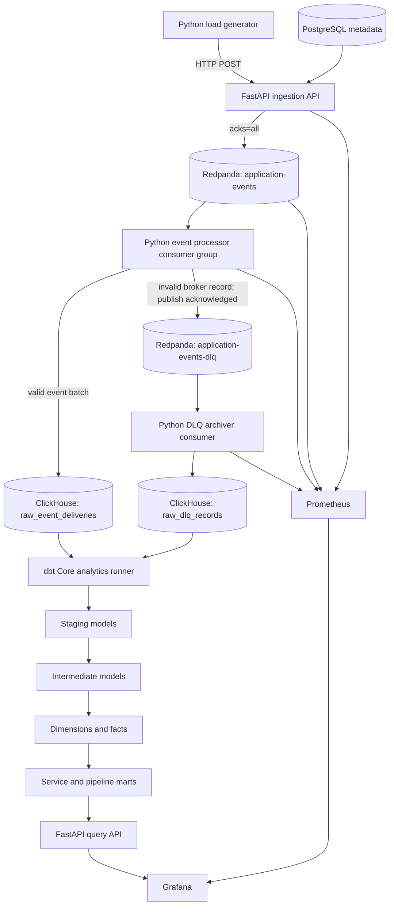
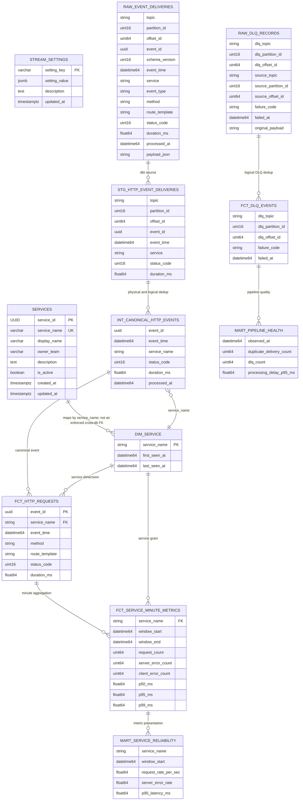

# PulseStream — Technical Architecture Document (TAD)

**Project:** PulseStream — Distributed Event Analytics & Reliability Platform  
**Document:** Technical Architecture Document  
**Version:** 1.0  
**Status:** MVP architecture baseline  
**Companion document:** `PulseStream_PRD.md`  
**Primary role alignment:** Analytics Engineer  
**Implementation style:** Local-first, Docker Compose, phase-by-phase delivery  

---

## 1. Purpose and architecture principles

This document translates the PulseStream product requirements into an implementation architecture. It defines component boundaries, event flow, persistence contracts, analytical grains, metric calculations, retry and commit behavior, observability, testing, and the exact build sequence.

### 1.1 Architecture principles

1. **Raw evidence is preserved.** Do not overwrite or silently discard original accepted event deliveries.
2. **Broker delivery is at-least-once.** Duplicate processing is expected and handled explicitly.
3. **Analytics are modeled, not hand-waved.** Metric definitions live in version-controlled SQL/dbt models and tests.
4. **Processing and analytical correctness are separate.** A successfully consumed message is not automatically a correct metric row.
5. **Failure paths are first-class.** Retry, lag, DLQ, last-success time, and reconciliation are visible.
6. **Bound resource usage.** Cap batch size, event size, retry count, and the number of concurrent local services.
7. **Keep the MVP explainable.** Do not add orchestration, distributed compute, or a custom frontend unless the core project is complete.
8. **Use explicit limitations.** A single-node local broker demonstrates partitions and consumer groups, not high availability.

### 1.2 Chosen stack

| Layer | Technology | Responsibility |
|---|---|---|
| Runtime | Python 3.12+ | Producer, API, consumers, utility commands |
| API | FastAPI + Pydantic | Ingestion, read queries, health, Prometheus endpoint |
| Broker | Redpanda | Partitioned event log and consumer groups |
| Kafka client | `confluent-kafka` Python client | Producer, consumer, manual offset commit, lag metadata |
| Analytics store | ClickHouse | Raw deliveries, DLQ archive, facts and aggregates |
| Metadata store | PostgreSQL | Service registry and stream configuration |
| Transformation | dbt Core + `dbt-clickhouse` | Staging, canonicalization, facts, marts, tests, docs |
| Monitoring | Prometheus | Scrape application and broker metrics |
| Dashboards | Grafana | Service analytics and pipeline reliability dashboards |
| Tests | pytest | Unit, integration, contract, reconciliation, resilience tests |
| Local runtime | Docker Compose | Reproducible local stack |

OpenTelemetry tracing is a P1 extension. It is not required for the P0 MVP acceptance criteria.

---

## 2. System architecture

### 2.1 Logical architecture



### 2.2 Runtime component boundaries

| Component | Runs as | Owns | Must not own |
|---|---|---|---|
| `api` | FastAPI container | External event contract validation, broker publishing, query endpoints, liveness/readiness | Event aggregation or long-running consumer loops |
| `load-generator` | CLI command/container | Synthetic workload generation and run manifest | Data correctness decisions in dbt |
| `event-consumer` | Python worker container | Broker consumption, consumer validation, valid raw writes, DLQ publication, manual commits | Business-facing metric definitions |
| `dlq-archiver` | Python worker container | DLQ topic consumption and ClickHouse archival | Repairing or replaying records automatically |
| `analytics-runner` | Python/dbt container | Serial dbt builds/tests on a fixed micro-batch cadence | Consuming broker messages |
| `clickhouse` | Database container | Event and analytical persistence | Service registry source of truth |
| `postgres` | Database container | Service metadata and stream settings | High-volume event storage |
| `prometheus` | Monitoring container | Metrics scraping and time-series retention | Analytical event facts |
| `grafana` | Dashboard container | Visualization | Source-of-truth metric calculations |

The FastAPI service and consumer workers are separate processes. This prevents a slow analytics sink from blocking ingestion HTTP requests or health endpoints.

### 2.3 Physical local deployment

The MVP runs one local Redpanda node, one ClickHouse instance, one PostgreSQL instance, and one instance of each application worker. Redpanda topics use replication factor 1 in the default development setup. This is a deliberately small demonstration topology, not a production high-availability design.

Suggested Compose services:

```text
redpanda
clickhouse
postgres
api
event-consumer
dlq-archiver
analytics-runner
prometheus
grafana
```

The load generator is invoked on demand and does not need to run continuously. Redpanda Console may be added under an optional Compose profile, but is not required for the MVP.

### 2.4 Data flow summary

1. The generator creates a v1 HTTP completion event with a stable `event_id`.
2. FastAPI validates the external contract. Invalid HTTP input is rejected before publication.
3. FastAPI publishes valid events to `application-events`, keyed by service and route template. It returns 202 only after broker acknowledgement.
4. The event consumer reads records with automatic offset commits disabled.
5. The consumer validates schema version and event semantics again.
6. Valid deliveries are written in bounded batches to ClickHouse. Invalid broker records are published to the DLQ topic.
7. Source offsets are committed only after the corresponding valid sink write or DLQ publication has been acknowledged.
8. A DLQ archiver persists DLQ records to ClickHouse and commits DLQ offsets only after the ClickHouse write succeeds.
9. dbt creates staging and canonical models, fact tables, and service/pipeline marts.
10. FastAPI reads marts and metadata; Grafana displays analytics and operational telemetry.

---

## 3. Event contract and broker design

### 3.1 Canonical event envelope v1

The API and consumer share one versioned Pydantic/schema definition. The canonical JSON shape is:

```json
{
  "event_id": "8a9b2d50-4fc6-4f6b-8dbe-741bbf7d4e1f",
  "schema_version": 1,
  "event_time": "2026-11-11T10:15:22.384Z",
  "producer": "load-generator",
  "service": "order-service",
  "event_type": "http.request.completed",
  "attributes": {
    "method": "POST",
    "route_template": "/orders",
    "status_code": 201,
    "duration_ms": 42.7,
    "trace_id": "4bf92f3577b34da6a3ce929d0e0e4736"
  }
}
```

The timestamp above is illustrative. All stored timestamps are normalized to UTC with millisecond precision.

| Field | Type | Required | Validation |
|---|---|---:|---|
| `event_id` | UUID | Yes | Stable logical identifier; generated once and retained across duplicate/replay attempts. |
| `schema_version` | Positive integer | Yes | MVP supports `1`; unknown versions are not silently coerced. |
| `event_time` | ISO-8601 timestamp | Yes | Must include timezone; normalize to UTC. |
| `producer` | String | Yes | Non-empty, bounded length. |
| `service` | String | Yes | Lowercase slug; must be registered or explicitly allowed by demo configuration. |
| `event_type` | String | Yes | MVP value is `http.request.completed`. |
| `attributes.method` | String | Yes | Uppercase HTTP method from an allow-list. |
| `attributes.route_template` | String | Yes | Templated route only; no full URL, query string, or raw user identifier. |
| `attributes.status_code` | Integer | Yes | 100 through 599. |
| `attributes.duration_ms` | Float | Yes | Greater than or equal to zero. |
| `attributes.trace_id` | String/null | No | Optional trace identifier; never a credential. |

### 3.2 Time metadata added by the platform

The producer event contract does not need to include ingestion/processing timestamps. These are assigned by platform components and stored separately:

- `broker_timestamp`: broker record timestamp when available.
- `processed_at`: UTC timestamp when the consumer successfully processed the record for the sink write.
- `failed_at`: UTC timestamp when a record is routed to DLQ.
- `archived_at`: UTC timestamp when a DLQ record is stored in ClickHouse.

`processing_delay_ms` is calculated as `processed_at - event_time`. Negative values are retained and can indicate clock skew; they must not be clamped silently to zero.

### 3.3 API validation versus DLQ validation

There are two intentionally different rejection boundaries:

1. **API boundary:** Structurally invalid external requests receive HTTP 4xx and never enter the main topic. These are API rejections, not DLQ records.
2. **Consumer boundary:** Records already present in the broker but rejected by the consumer (unsupported version, invalid semantic values, malformed injected payload, or compatibility failure) are published to the DLQ topic. This path is exercised by direct broker injection/integration tests and protects against producers that bypass the API or send older/bad records.

This distinction prevents dashboards from mixing HTTP request validation failures with messages that were actually accepted into the event log.

### 3.4 Topic configuration

| Topic | Partitions | Replication factor | Purpose | Retention |
|---|---:|---:|---|---|
| `application-events` | 3 | 1 | Accepted event stream | 7 days for local demo |
| `application-events-dlq` | 3 | 1 | Invalid records and failure metadata | 7 days for local demo |

Topic names and partition counts are configurable through environment variables, but tests assume the default three partitions unless overridden.

### 3.5 Partition-key strategy

Use a stable key derived from:

```text
{service}|{route_template}
```

The broker hashes this key to a partition. This gives ordering for a service-route pair and provides more key diversity than using only the service name. HTTP request-completion events are independent observations, so the MVP does not require a global order across a service's different routes.

Trade-off:

- More route keys can distribute load across partitions.
- A hot service-route pair can still create a hot partition.
- Ordering is guaranteed only within one partition, not across the whole topic.
- Adding partitions can change key-to-partition mapping for future records; do not claim a stable global ordering after repartitioning.

The consumer group can process up to the number of partitions concurrently. With three partitions, more than three active consumers in the same group do not increase partition-level parallelism.

### 3.6 Producer settings

The producer should use:

- `acks=all`.
- Producer idempotence enabled.
- Bounded message size and delivery timeout.
- Retry behavior supplied by the client within a bounded delivery timeout.
- Explicit publish callback/error handling.

Producer idempotence protects against certain duplicate writes caused by producer retries within a producer session. It does not eliminate application-level duplicates (for example, the same event ID submitted twice as separate API requests). The analytical layer still needs `event_id` deduplication.

---

## 4. Processing and delivery semantics

### 4.1 Consumer configuration

- Consumer group: `pulsestream-event-processors`.
- `enable.auto.commit=false`.
- Bounded `max.poll.records`/batch size.
- Explicit polling and graceful shutdown.
- Per-partition ordered handling of records before committing offsets.
- Consumer lag exported by partition where possible.

Use a configurable default maximum of 500 records per processing batch and a bounded poll/wait interval. Tune only after benchmark evidence.

### 4.2 Valid-record path

1. Poll records.
2. Decode payload and validate envelope version and required attributes.
3. Convert timestamps and scalar fields to canonical types.
4. Preserve original JSON payload and broker coordinates.
5. Batch-insert valid records into `raw_event_deliveries`.
6. Wait for ClickHouse to confirm the insert.
7. Commit the next offset for each partition only after all earlier records in that partition have been durably handled.

If a batch contains records from multiple partitions, track the highest contiguous successfully handled offset per partition. Do not commit an offset past an earlier record that has not been persisted or dead-lettered.

### 4.3 Invalid-record path

1. Preserve the original payload and source topic/partition/offset.
2. Add failure code, bounded failure message, and `failed_at`.
3. Publish to `application-events-dlq`.
4. Wait for DLQ broker acknowledgement.
5. Mark the source record as handled and commit its source offset only when all earlier records in that partition are handled.

A DLQ publish failure is not treated as successful handling. The source offset remains uncommitted so the record can be retried.

### 4.4 ClickHouse outage and bounded retries

For a valid event batch:

- Retry transient ClickHouse errors with exponential backoff and jitter.
- Use a maximum retry count and maximum elapsed retry time.
- Do not drop the in-flight batch after the retry limit.
- Pause the affected partition(s) or stop advancing consumption safely; expose retry state and lag.
- Keep memory bounded. Do not continue polling an unbounded number of new batches into RAM.
- On recovery, retry or re-consume the uncommitted records and continue.

A process restart may cause the same broker record to be written again if the sink write succeeded but offset commit did not. This is expected at-least-once behavior. The raw table retains broker coordinates so dbt can remove physical duplicate writes from canonical analytical delivery rows.

### 4.5 DLQ archiver

- Consumer group: `pulsestream-dlq-archiver`.
- Reads `application-events-dlq`.
- Inserts original payload, source coordinates, DLQ coordinates, and failure metadata into `raw_dlq_records`.
- Commits DLQ offsets only after ClickHouse acknowledges the write.
- Uses the same bounded retry and graceful shutdown principles.

The DLQ topic is the durable failure queue; the ClickHouse table is its analytical archive. If ClickHouse is unavailable, DLQ archiver lag grows while records remain in Redpanda.

### 4.6 Graceful shutdown

On SIGTERM/SIGINT:

1. Stop accepting new generator work / consumer polling.
2. Finish or safely abandon the in-flight batch without committing incomplete offsets.
3. Flush producer/DLQ acknowledgements where applicable.
4. Commit only successfully handled contiguous offsets.
5. Close broker/database clients cleanly.
6. Emit a final log with processed, retried, DLQ, and uncommitted counts.

### 4.7 Delivery guarantee statement

PulseStream provides at-least-once processing from the broker to the analytics sink. It does not provide exactly-once end-to-end delivery. Idempotent producer settings, source offset discipline, raw broker coordinates, and dbt canonicalization reduce duplicate impact but do not turn the entire multi-system workflow into a single atomic transaction.

---

## 5. Storage architecture

### 5.1 PostgreSQL — metadata store

PostgreSQL is the source of truth for service metadata and stream configuration. It is not used for high-volume events.

#### Table: `services`

**Grain:** one row per registered application service.

| Column | Type | Null? | Key | Meaning |
|---|---|---:|---|---|
| `service_id` | UUID | No | PK | Internal service identifier. |
| `service_name` | VARCHAR(100) | No | UNIQUE | Canonical lowercase slug, e.g. `order-service`. |
| `display_name` | VARCHAR(150) | No | | Human-readable service name. |
| `owner_team` | VARCHAR(150) | Yes | | Team responsible for the service. |
| `description` | TEXT | Yes | | Short service description. |
| `is_active` | BOOLEAN | No | | Whether generator/API should treat it as active. |
| `created_at` | TIMESTAMPTZ | No | | Creation timestamp. |
| `updated_at` | TIMESTAMPTZ | No | | Last update timestamp. |

Constraints: primary key on `service_id`; unique constraint on `service_name`; `service_name` must match a lowercase slug pattern.

#### Table: `stream_settings`

**Grain:** one row per named configuration setting.

| Column | Type | Null? | Key | Meaning |
|---|---|---:|---|---|
| `setting_key` | VARCHAR(120) | No | PK | Stable configuration key. |
| `setting_value` | JSONB | No | | Configuration value. |
| `description` | TEXT | Yes | | Human-readable setting purpose. |
| `updated_at` | TIMESTAMPTZ | No | | Last update time. |

Examples: default topic name, default partition count, consumer batch size, allowed-lateness minutes, deduplication horizon days. Secrets must not be stored in this table.

#### PostgreSQL relationships

The current MVP has no hard cross-database foreign key from ClickHouse event tables to PostgreSQL. `service_name` is the conformed natural key in the event contract and maps to `services.service_name` by application/data-quality convention. Cross-database referential integrity is checked by tests and API validation.

### 5.2 ClickHouse — event and analytical store

ClickHouse stores high-volume event deliveries, dead-letter evidence, and analytical models.

#### Table: `raw_event_deliveries`

**Physical grain:** one sink insert row for one processing attempt of one broker record. The same broker coordinate can appear more than once if a sink insert is repeated after an offset-commit failure.

Recommended engine: `MergeTree`. Partition by event month; order primarily by service and event time for common dashboard filters.

| Column | ClickHouse type | Null? | Meaning |
|---|---|---:|---|
| `topic` | LowCardinality(String) | No | Source broker topic. |
| `partition_id` | UInt16 | No | Source partition. |
| `offset_id` | UInt64 | No | Source offset. |
| `event_id` | UUID | No | Logical event identifier. |
| `schema_version` | UInt16 | No | Event contract version. |
| `event_time` | DateTime64(3, 'UTC') | No | Time the HTTP request completed. |
| `producer` | LowCardinality(String) | No | Event producer name. |
| `service` | LowCardinality(String) | No | Canonical service slug. |
| `event_type` | LowCardinality(String) | No | `http.request.completed`. |
| `method` | LowCardinality(String) | No | HTTP method. |
| `route_template` | String | No | Normalized route template. |
| `status_code` | UInt16 | No | HTTP response status code. |
| `duration_ms` | Float64 | No | Request duration in milliseconds. |
| `trace_id` | Nullable(String) | Yes | Optional trace identifier. |
| `broker_timestamp` | DateTime64(3, 'UTC') | Yes | Broker record timestamp, if available. |
| `processed_at` | DateTime64(3, 'UTC') | No | Consumer processing/sink-write time. |
| `payload_json` | String | No | Original accepted event JSON for audit. |
| `payload_hash` | FixedString(64) | No | SHA-256 hex digest of canonical payload. |

Logical broker-record identity: `(topic, partition_id, offset_id)`. ClickHouse does not enforce uniqueness for these columns; dbt applies the logical deduplication.

Suggested table layout:

```sql
ENGINE = MergeTree
PARTITION BY toYYYYMM(event_time)
ORDER BY (service, event_time, event_id, topic, partition_id, offset_id)
```

The raw table is append-oriented. Do not run in-place updates to fix event values; use corrected/replayed events and explicit analytical logic.

#### Table: `raw_dlq_records`

**Physical grain:** one ClickHouse sink insert attempt for one DLQ broker record.

| Column | ClickHouse type | Null? | Meaning |
|---|---|---:|---|
| `dlq_topic` | LowCardinality(String) | No | DLQ topic. |
| `dlq_partition_id` | UInt16 | No | DLQ partition. |
| `dlq_offset_id` | UInt64 | No | DLQ offset. |
| `source_topic` | LowCardinality(String) | No | Original source topic. |
| `source_partition_id` | UInt16 | No | Original source partition. |
| `source_offset_id` | UInt64 | No | Original source offset. |
| `event_id` | Nullable(String) | Yes | Parsed event ID, if available. |
| `schema_version` | Nullable(UInt16) | Yes | Parsed schema version, if available. |
| `failure_code` | LowCardinality(String) | No | Stable error category. |
| `failure_message` | String | No | Bounded diagnostic message; never include secrets. |
| `failed_at` | DateTime64(3, 'UTC') | No | Time the processor classified the record as invalid. |
| `archived_at` | DateTime64(3, 'UTC') | No | Time the archiver wrote the row. |
| `original_payload` | String | No | Original malformed/unsupported payload. |

Logical DLQ record identity: `(dlq_topic, dlq_partition_id, dlq_offset_id)`.

Suggested layout:

```sql
ENGINE = MergeTree
PARTITION BY toYYYYMM(failed_at)
ORDER BY (failure_code, failed_at, dlq_topic, dlq_partition_id, dlq_offset_id)
```

#### Retention

For local development, configure a documented retention policy. A practical default is seven days for broker topics and raw ClickHouse delivery/DLQ data, with longer retention for derived minute aggregates if desired. Retention must not be shorter than the seven-day deduplication/replay guarantee. When a reviewer changes retention, the duplicate guarantee must be updated accordingly.

### 5.3 ClickHouse dbt model layers

| Layer | Model | Materialization | Grain / purpose |
|---|---|---|---|
| Source | `src_raw_event_deliveries` | Source declaration | Physical raw delivery rows. |
| Source | `src_raw_dlq_records` | Source declaration | Physical DLQ archive rows. |
| Staging | `stg_http_event_deliveries` | View | Typed, renamed, normalized valid delivery rows. |
| Staging | `stg_dlq_deliveries` | View | Typed and normalized DLQ rows. |
| Intermediate | `int_broker_delivery_dedup` | View | One row per source topic/partition/offset, eliminating repeated ClickHouse sink writes. |
| Intermediate | `int_http_event_dedup_audit` | View | Valid logical deliveries ranked by event ID with duplicate indicator/rank. |
| Intermediate | `int_canonical_http_events` | View | One canonical event per event ID within the current deduplication horizon. |
| Dimension | `dim_service` | View/table | One row per service natural key. |
| Fact | `fct_http_requests` | View or incremental table | One canonical HTTP completion event per `event_id`. |
| Fact | `fct_service_minute_metrics` | Incremental table | One row per service × UTC minute. |
| Fact | `fct_dlq_events` | View/table | One logical DLQ record per DLQ broker coordinate. |
| Mart | `mart_service_reliability` | View | Service-level request/error/latency metrics with metric ratios. |
| Mart | `mart_pipeline_health` | View | DLQ volume, duplicate volume, processing delay and pipeline summaries. |
| Mart | `mart_late_events` | View | Events outside the automatic 15-minute correction window requiring backfill/reconciliation. |

#### Physical duplicate versus logical duplicate

There are two different duplicate types and both must be measured:

1. **Physical sink retry duplicate:** same `(topic, partition_id, offset_id)` was inserted into ClickHouse more than once because the consumer retried after an uncertain write/commit outcome. Keep one analytical delivery row for that broker record.
2. **Logical event duplicate:** different broker coordinates contain the same `event_id` because a producer/API/client sent the same logical event again. Preserve the extra delivery in the audit model, flag it, and include only one canonical event in request metrics within the seven-day guarantee.

Do not collapse these into a single `duplicate_count` without retaining both definitions. Expose `physical_sink_retry_duplicate_count` and `duplicate_delivery_count` separately where practical.

### 5.4 Dimensional design and explicit grains

#### `dim_service`

- **Grain:** one row per canonical service name.
- **Natural key:** `service_name`.
- **Attributes:** service name, first observed event time, last observed event time, active/known indicator.
- **Source:** distinct canonical service names, optionally enriched from PostgreSQL service registry through a small metadata sync/API join.
- **MVP simplification:** use `service_name` as the natural dimension key rather than adding an unnecessary surrogate integer key.

#### `fct_http_requests`

- **Grain:** one canonical row per logical HTTP request-completion `event_id` within the deduplication guarantee.
- **Dimensions:** service, event time, method, route template, status code.
- **Measures:** duration milliseconds, processing delay milliseconds, error classification flags.
- **Logical unique key:** `event_id`.

#### `fct_service_minute_metrics`

- **Grain:** one row per `service_name × window_start` where `window_start` is a fixed UTC minute.
- **Dimensions:** service, UTC minute.
- **Measures:** request count, 5xx count, 4xx count, 2xx/3xx count, p50/p95/p99 latency, p50/p95 processing delay, and count of eligible events.
- **Logical unique key:** `(service_name, window_start)`.

#### `fct_dlq_events`

- **Grain:** one logical DLQ broker record identified by `(dlq_topic, dlq_partition_id, dlq_offset_id)`.
- **Dimensions:** failure code, source topic, failed time.
- **Measures:** record count (one per logical DLQ record).

#### Aggregate correction and incremental materialization

The `fct_service_minute_metrics` model is rebuilt for the current UTC date and previous UTC date on each analytics refresh. Use the ClickHouse dbt `insert_overwrite` incremental strategy with date partitioning so affected daily partitions are replaced as complete partitions. This supports repeated correction of recent minute windows without appending duplicate aggregates.

For the MVP, restrict the incremental query to the current and previous UTC date. Older partitions are treated as closed and can be rebuilt explicitly by a backfill/full-refresh command. The model should include only canonical events that arrive no more than 15 minutes after `event_time`; older records remain in `fct_http_requests`/`mart_late_events` and are excluded from automatic real-time aggregate correction until backfill.

`dbt-clickhouse` documents the `insert_overwrite` incremental strategy as partition replacement and requires `partition_by`; the adapter notes a limitation for distributed materializations. PulseStream uses a single local ClickHouse instance and ordinary MergeTree tables for the MVP. Confirm the selected adapter/server versions and integration-test the exact configuration before relying on it. If adapter compatibility is problematic, use a safe full-refresh table build for the small demo dataset rather than silently falling back to append-only aggregates. See the official [ClickHouse dbt materializations documentation](https://github.com/ClickHouse/clickhouse-docs/blob/main/docs/integrations/data-ingestion/etl-tools/dbt/materializations.md).

### 5.5 Complete ERD and model lineage

The following ERD separates the relational metadata store from ClickHouse analytical data. `service_name` is the cross-store natural key; there is intentionally no cross-database FK.



**Important:** The diagram uses PK/FK-style labels to communicate logical grain for ClickHouse dbt models. ClickHouse does not enforce the event/fact uniqueness or cross-model foreign keys as PostgreSQL does. Those contracts are tested in dbt and reconciliation SQL. The only physically enforced relational PK/unique constraints in the MVP are in PostgreSQL.

---

## 6. Analytics and metric architecture

### 6.1 Time semantics

- `event_time` answers: when did the request complete in the simulated application?
- `broker_timestamp` answers: when did the broker record the message?
- `processed_at` answers: when did the consumer process/write the record?
- `failed_at` answers: when did the consumer classify the broker record as invalid?
- `archived_at` answers: when was the DLQ record persisted in ClickHouse?

Service metrics are grouped by `event_time`. Processing health metrics use broker/processing timestamps. Never use processing time as a substitute for event time without an explicitly named metric.

### 6.2 Window definition

- Window size: 1 minute.
- Window alignment: UTC wall-clock minute boundaries.
- `window_start`: inclusive minute start.
- `window_end`: exclusive minute end.
- Example: event at `10:15:22.384Z` belongs to `[10:15:00Z, 10:16:00Z)`.
- `request_rate_per_sec` is `request_count / 60`, the average rate for the complete fixed minute.

### 6.3 Metric contracts

| Metric | SQL-level calculation | Null/edge behavior |
|---|---|---|
| `request_count` | `count()` of canonical events in service-minute group. | 0 only when a row is intentionally generated for an empty bucket; otherwise no row. |
| `request_rate_per_sec` | `request_count / 60.0`. | Fixed-window average, not instantaneous. |
| `server_error_count` | `countIf(status_code BETWEEN 500 AND 599)`. | Integer count. |
| `server_error_rate` | `server_error_count / request_count`. | `NULL` if denominator is zero. |
| `client_error_count` | `countIf(status_code BETWEEN 400 AND 499)`. | Keep separate from server errors. |
| `success_or_redirect_count` | `countIf(status_code BETWEEN 100 AND 399)`. | Together, 1xx–3xx, 4xx and 5xx partition the accepted 100–599 statuses. |
| `latency_p50_ms` | `quantileTDigest(0.50)(duration_ms)`. | Approximate. For small correctness fixtures, compare against exact quantile with tolerance. |
| `latency_p95_ms` | `quantileTDigest(0.95)(duration_ms)`. | Approximate tail percentile; method must be displayed/documented. |
| `latency_p99_ms` | `quantileTDigest(0.99)(duration_ms)`. | Approximate tail percentile; may be unstable for very small sample sizes. |
| `processing_delay_ms` | `dateDiff('millisecond', event_time, processed_at)`. | Preserve negative values; report p50/p95 and negative-delay count if useful. |
| `duplicate_delivery_count` | Count of non-canonical logical deliveries per `event_id` within horizon. | Separate from repeated sink writes of the same broker coordinate. |
| `physical_sink_retry_duplicate_count` | Count of extra raw rows sharing broker topic/partition/offset. | Diagnostic for uncertain write/commit retries. |
| `invalid_event_count` | Count of logical records archived from DLQ. | API 4xx validation failures are not included. |
| `consumer_lag` | Per-partition high-watermark offset minus committed/processed offset, using a consistent offset convention. | A gauge; do not sum over time. |
| `last_successful_processing_at` | Timestamp of last batch whose sink write succeeded and whose corresponding offsets were committed. | Must not advance on failed writes. |

### 6.4 Status classification

Use mutually exclusive buckets:

- 100–399: `success_or_redirect`.
- 400–499: `client_error`.
- 500–599: `server_error`.

The core `server_error_rate` uses only 5xx. Do not use a vague generic “error rate” without specifying whether client errors are included. API-level request rejections are operational ingestion errors and not application HTTP event response codes.

### 6.5 Percentiles

Use ClickHouse t-digest quantile functions in the operational minute mart for performance and compact aggregation. Label them approximate in API documentation, dashboard panel descriptions, and README. In tests, use a small known fixture and compare approximate values to exact quantile outputs within a documented tolerance. Do not claim exact p95/p99 unless the query is explicitly using an exact method.

### 6.6 Late-event processing

- An event whose `processed_at` is no more than 15 minutes after its `event_time` is eligible for automatic service-minute correction.
- Each dbt refresh recomputes the current and previous UTC date partitions, allowing recently arrived events to update the affected minute.
- An event arriving more than 15 minutes after its event time is retained in the canonical event fact, flagged in `mart_late_events`, and excluded from automatic minute-mart correction until an explicit backfill.
- Backfill must be an explicit command with a recorded time range and a reconciliation result.

This is an intentional MVP policy, not a claim that arbitrarily late events are automatically corrected.

### 6.7 dbt build cadence

The `analytics-runner` executes a serialized workflow approximately once per minute:

```text
wait for ClickHouse readiness
    -> dbt build --select staging intermediate dimensions facts marts
    -> emit build result and duration
    -> sleep until next scheduled interval
```

There must be only one active dbt build process per local environment. If a build takes longer than the interval, the runner starts the next run only after the previous run completes and the configured delay elapses; runs must not overlap.

For the minute fact, configure a ClickHouse incremental model with:

- `incremental_strategy='insert_overwrite'`.
- `partition_by` using the UTC date of `window_start`.
- `order_by` based on `(window_start, service_name)`.
- The query recomputes all eligible events for the current and previous UTC date partitions.

The exact `dbt-clickhouse` package and ClickHouse server versions must be pinned in dependency/container configuration and tested together. Do not use `append` for a corrected aggregate model because late events would create duplicate aggregate rows.

---

## 7. API design

### 7.1 API responsibilities

FastAPI exposes event ingestion, service metadata, read-only analytics queries, health checks, and Prometheus metrics. The API should not directly calculate complex percentiles from raw payloads; it reads the dbt marts.

### 7.2 MVP endpoints

| Method | Path | Purpose | Success response |
|---|---|---|---|
| POST | `/v1/events` | Publish one event. | `202 Accepted` after broker acknowledgement. |
| POST | `/v1/events/batch` | Publish a bounded batch. | `202 Accepted` with accepted/rejected counts or per-item result. |
| GET | `/v1/services` | List registered services. | Service metadata list. |
| GET | `/v1/metrics/services` | Query service metrics by time range and optional service. | Minute-level metric rows. |
| GET | `/v1/metrics/pipeline` | Query pipeline health summaries. | Lag/DLQ/duplicate/delay/last-success summary. |
| GET | `/health/live` | Process liveness. | `200` while API process is running. |
| GET | `/health/ready` | Dependency readiness. | `200` only when required dependencies are reachable. |
| GET | `/metrics` | Prometheus scrape endpoint. | Prometheus exposition format. |

### 7.3 Query parameter rules

`GET /v1/metrics/services` should support:

- `start`: inclusive UTC ISO-8601 timestamp.
- `end`: exclusive UTC ISO-8601 timestamp.
- `service`: optional canonical service slug.
- `granularity`: MVP supports `1m` only.

Reject invalid timestamp formats, start >= end, unsupported granularity, and excessively wide ranges beyond a configurable local safety limit. Return timestamps in UTC and preserve `null` metric values.

### 7.4 Example response

```json
{
  "granularity": "1m",
  "timezone": "UTC",
  "metrics": [
    {
      "service": "order-service",
      "window_start": "2026-11-11T10:15:00Z",
      "window_end": "2026-11-11T10:16:00Z",
      "request_count": 120,
      "request_rate_per_sec": 2.0,
      "server_error_count": 6,
      "server_error_rate": 0.05,
      "client_error_count": 3,
      "latency_p50_ms": 38.2,
      "latency_p95_ms": 180.4,
      "latency_p99_ms": 260.1,
      "percentile_method": "t-digest approximate"
    }
  ]
}
```

The values above are illustrative and must not be used as benchmark claims.

---

## 8. Observability architecture

### 8.1 Prometheus metrics

Use bounded-cardinality labels. Do not put `event_id`, `trace_id`, raw URL, or other high-cardinality identifiers into Prometheus labels.

| Metric name | Type | Labels | Meaning |
|---|---|---|---|
| `pulsestream_ingest_requests_total` | Counter | `result`, `endpoint` | API ingestion requests by outcome. |
| `pulsestream_events_published_total` | Counter | `service`, `topic` | Events acknowledged by broker. |
| `pulsestream_publish_duration_seconds` | Histogram | `topic` | Broker publish latency. |
| `pulsestream_consumer_records_total` | Counter | `consumer`, `outcome` | Records handled as valid, invalid, or failed. |
| `pulsestream_consumer_batch_size` | Histogram | `consumer` | Number of records per batch. |
| `pulsestream_consumer_batch_duration_seconds` | Histogram | `consumer` | Batch handling duration. |
| `pulsestream_consumer_lag` | Gauge | `consumer_group`, `topic`, `partition` | Estimated lag by partition. |
| `pulsestream_retries_total` | Counter | `component`, `dependency`, `reason` | Retry attempts. |
| `pulsestream_clickhouse_write_errors_total` | Counter | `consumer` | ClickHouse write failures. |
| `pulsestream_dlq_published_total` | Counter | `failure_code` | Records successfully published to DLQ. |
| `pulsestream_last_successful_processing_timestamp_seconds` | Gauge | `consumer` | Unix timestamp of last successful persisted-and-committed batch. |
| `pulsestream_processing_delay_seconds` | Histogram | `service` | Event-to-processing delay, with negative values handled separately if histogram implementation cannot represent them. |
| `pulsestream_analytics_build_duration_seconds` | Histogram | `result` | dbt build duration. |
| `pulsestream_analytics_build_last_success_timestamp_seconds` | Gauge | none | Last successful dbt build time. |

If negative processing delays cannot be represented meaningfully in the chosen histogram, expose a separate `pulsestream_clock_skew_events_total` counter and a non-negative-delay histogram, while retaining the signed value in ClickHouse analytics.

### 8.2 Consumer lag

For each assigned partition, derive lag using a consistent offset convention, for example:

`lag = high_watermark_offset - committed_offset`

Ensure both values use the same “next offset” convention. Validate with an integration test that produces a known number of messages and confirms the lag reaches zero after all are processed and committed. If exact per-group committed offsets are difficult to retrieve from the selected client version, expose Redpanda's supported consumer-group metrics/exporter and document its semantics rather than inventing a lag value.

### 8.3 Grafana dashboards

**Dashboard A — Service Analytics**

1. Request count/rate by service.
2. 5xx server error rate by service.
3. 4xx client error rate by service.
4. p50/p95/p99 latency by service.
5. Service comparison table.
6. Minute-level time series with UTC time range.

**Dashboard B — Pipeline Reliability**

1. Ingestion API accepted/rejected rate.
2. Producer publish latency.
3. Consumer throughput.
4. Consumer lag by partition.
5. Retry and ClickHouse write-error rates.
6. DLQ count by failure code.
7. Processing-delay p50/p95.
8. Last successful processing timestamp.
9. dbt last-success time and build duration.

Each panel must document units and aggregation method. The service dashboard is based on dbt marts; the pipeline dashboard may combine Prometheus metrics with ClickHouse DLQ/duplicate summaries.

### 8.4 Logging

Use structured JSON logs with:

- `timestamp`, `level`, `service/component`, `message`.
- `topic`, `partition`, `offset` where applicable.
- `event_id` in application logs only (not metric labels).
- `batch_id` or processing correlation ID.
- `retry_attempt`, `failure_code`, and dependency name where applicable.

Do not log full sensitive payloads. For malformed messages, log a bounded payload hash and a truncated/sanitized excerpt only when needed for debugging.

---

## 9. Security, privacy, and configuration

### 9.1 MVP security boundary

The default local Compose deployment is a development environment and does not implement public multi-user authentication. All services should bind to localhost or the Docker network unless a reviewer deliberately changes the configuration.

### 9.2 Data protection rules

- Synthetic data only.
- No tokens, secrets, request bodies, cookies, authorization headers, or personal data.
- Route templates only, not full request paths containing identifiers.
- Bound payload size and string lengths.
- Sanitize error messages before storing in DLQ.
- Do not expose database credentials through API responses or logs.

### 9.3 Configuration management

Use `.env.example` for variable names and safe local defaults. Keep real `.env` out of Git. Environment variables should cover:

- Redpanda bootstrap server and topic names.
- Topic partition settings.
- Producer delivery timeout.
- Consumer group IDs and batch size.
- ClickHouse host, port, database, user, password.
- PostgreSQL host, port, database, user, password.
- Deduplication horizon and allowed lateness.
- dbt refresh interval and lookback dates.
- Prometheus/Grafana ports and credentials.

Use a non-root application user in containers where practical. Database credentials should be least-privileged; the query API should not use the ClickHouse ingestion writer credential if separate users can be provisioned easily.

---

## 10. Testing and data-quality architecture

### 10.1 Test layers

| Layer | Framework | What it verifies |
|---|---|---|
| Unit | pytest | Pydantic validation, timestamp normalization, status classification, key building, retry policy, SQL helper functions. |
| Contract | pytest | Event v1 schema examples, required/optional fields, unsupported schema versions. |
| API integration | FastAPI TestClient + test broker or local Compose | 202 only after broker ack, 4xx for invalid input, batch limits, health endpoints. |
| Consumer integration | Local Redpanda + ClickHouse | Valid writes, DLQ publication, manual offsets, duplicate replay. |
| dbt | dbt tests | Not-null, accepted values, logical uniqueness, relationship conventions, reconciliation. |
| Failure injection | pytest + Docker Compose test controls | Consumer stop/restart, ClickHouse outage, broker/DLQ write failure, bursts, late events. |
| Performance | Load generator + metrics | Throughput, p95 visibility delay, lag, retries, resource use. |

### 10.2 Required dbt tests

At minimum:

- `not_null` on canonical `event_id`, `service_name`, `event_time`, `status_code`, and `duration_ms`.
- Accepted values for `event_type`, `schema_version`, `method`, and status-code range.
- `unique` on `fct_http_requests.event_id` within its active deduplication scope.
- `unique` on `dim_service.service_name`.
- Composite uniqueness on `(service_name, window_start)` in `fct_service_minute_metrics`.
- Non-negative `duration_ms`.
- `server_error_count <= request_count`.
- `client_error_count <= request_count`.
- Status bucket counts sum to `request_count`.
- Service fact keys map to `dim_service` by `service_name`.
- Aggregate count reconciles to eligible canonical event facts.
- DLQ fact logical key is unique after broker-coordinate deduplication.

### 10.3 Controlled reconciliation

The load generator creates a run manifest, for example `artifacts/runs/<run_id>.json`, containing:

- Run ID and random seed.
- Start/end time.
- Event IDs generated.
- Expected accepted/rejected categories.
- Expected duplicate IDs and number of extra publications.
- Expected intentionally invalid broker-injected records.
- Service/status distribution.

Reconciliation queries the broker coordinate ranges and ClickHouse/dbt datasets. For completed and committed source offsets:

```text
logical source records
  = valid logical deliveries
  + invalid records successfully routed to DLQ

valid logical deliveries
  = canonical unique event IDs
  + duplicate logical deliveries
```

Repeated ClickHouse writes for the same broker coordinate are separately counted as physical sink retry duplicates and do not increase the logical source record count.

For eligible events in a given service/time range:

```text
SUM(fct_service_minute_metrics.request_count)
  = COUNT(fct_http_requests eligible for automatic correction)
```

Any mismatch must be reported with a category and sample broker coordinates/event IDs. Do not print only “pass” when a count is missing; show expected, actual, difference, and diagnostic status.

### 10.4 Correctness fixtures

Create a deterministic fixture with known events, for example:

- 10 canonical events for one service and minute.
- 2 repeated event IDs published at different broker offsets.
- 1 malformed broker message.
- A known set of status codes across 2xx/3xx, 4xx, and 5xx.
- Known durations to test percentile calculations.
- One event delayed by 10 minutes (inside correction window).
- One event delayed by 20 minutes (outside automatic correction window).

Expected counts and quantiles should be calculated independently in Python or explicit SQL fixture assertions. Do not calculate expected values using the same production model logic being tested.

### 10.5 Failure scenario test matrix

| Scenario | Injection | Expected behavior | Verification |
|---|---|---|---|
| Invalid API payload | POST malformed JSON/schema | API 4xx; no main-topic publish | API test + broker record count. |
| Invalid broker record | Publish unsupported schema/malformed payload directly | Consumer publishes DLQ record, then commits source offset | DLQ topic and ClickHouse archive. |
| Duplicate event ID | Publish two valid records with same ID | Raw delivery audit has both; canonical fact has one | dbt rank/unique test and duplicate metric. |
| Consumer stopped | Stop event-consumer while producing | Lag increases | Per-partition lag panel. |
| Consumer restarted | Start consumer again | Processing catches up and lag returns toward zero | Committed offsets, last-success time, reconciliation. |
| ClickHouse outage | Stop ClickHouse while valid events arrive | Retries; no valid source offset commit before successful sink write; lag increases | Consumer logs/metrics, committed offsets, recovery reconciliation. |
| Burst | Raise generator to 500 events/sec for a bounded interval | Lag may rise, then recover after burst | Lag curve and time-to-catch-up. |
| Late event within 15m | Publish event whose event_time is 10m old | Event appears in corrected minute metric after dbt refresh | Before/after mart query. |
| Late event outside 15m | Publish event whose event_time is 20m old | Event is retained and flagged; automatic mart does not silently rewrite old closed minute | `mart_late_events` and backfill test. |
| DLQ archiver outage | Stop ClickHouse or archiver | DLQ topic lag rises; DLQ records remain durable | DLQ group lag and later archive reconciliation. |

---

## 11. Operational runbook expectations

The repository must include `docs/operations/runbook.md` with exact commands for:

1. Start and stop the stack.
2. Check service health and logs.
3. Generate baseline traffic.
4. Open Grafana and API documentation.
5. Stop/restart the event consumer.
6. Stop/restart ClickHouse.
7. Inject malformed broker events.
8. Replay a selected DLQ record after correction.
9. Run dbt build/tests.
10. Run reconciliation.
11. Run benchmark profiles.
12. Clean local volumes and reset the demo environment.

The runbook must warn that removing Docker volumes deletes the local demo data.

### 11.1 Replay procedure

The MVP replay operation should be explicit and auditable:

- Select one or more DLQ records by DLQ topic/partition/offset or run ID.
- Correct the payload or map it to a supported schema version.
- Publish to the main topic with original `event_id` retained where the message represents the same logical event.
- Add replay metadata in broker headers or a wrapper field when possible, without breaking the v1 event contract.
- Verify that the duplicate/canonical-event rules prevent replay from inflating metrics.
- Record the replay count and outcome in the run manifest or operator log.

Do not automatically replay every DLQ record in the MVP.

---

## 12. Benchmark architecture and methodology

### 12.1 Initial profiles

| Profile | Target | Duration | Objective |
|---|---:|---:|---|
| Baseline | 100 events/sec | 5 minutes | Establish steady behavior. |
| Elevated | 250 events/sec | 5 minutes | Observe throughput and processing delay. |
| Burst | 500 events/sec | 30–60 seconds | Observe transient lag and recovery. |
| Stretch | 1,000 events/sec | Optional | Attempt only if hardware/resource limits allow stable results. |

These are workload targets, not promises that every machine will sustain them.

### 12.2 Measurement definitions

- **Ingestion throughput:** broker-acknowledged events divided by elapsed generation time.
- **Processing throughput:** successfully handled logical broker records divided by processing interval.
- **Ingestion-to-query visibility delay:** time between event publication/creation and the first analytics refresh in which the event is queryable. Clearly state the chosen start timestamp.
- **Consumer lag:** per-partition offset difference using consistent offset conventions.
- **Time to catch up:** elapsed time from the end of a backlog-producing condition until lag returns to the chosen baseline (normally zero or a small steady-state value).
- **Loss/reconciliation difference:** expected logical source records minus accounted valid/duplicate/DLQ records. Must be zero for a completed controlled run, or explained with a concrete boundary such as records not yet committed.

### 12.3 Report contents

Save results in `docs/quality/benchmark-report.md` and machine-readable output under `artifacts/benchmarks/`. Include hardware, software versions, topic/partition configuration, producer and consumer counts, batch sizes, event size, service distribution, error rate, duplicate rate, whether Grafana/dbt were active, and the observed results.

Do not compare benchmark numbers from different machines without stating the environment difference. Never invent or extrapolate results beyond measurements.

---

## 13. Repository layout and module boundaries

Proposed repository: `pulsestream-event-analytics`.

```text
pulsestream-event-analytics/
├── app/
│   ├── api/
│   │   ├── main.py
│   │   ├── routes/
│   │   │   ├── events.py
│   │   │   ├── metrics.py
│   │   │   ├── services.py
│   │   │   └── health.py
│   │   ├── dependencies.py
│   │   └── schemas/
│   ├── contracts/
│   │   ├── events_v1.py
│   │   └── validation.py
│   ├── producer/
│   │   ├── kafka_producer.py
│   │   └── load_generator.py
│   ├── consumers/
│   │   ├── event_processor.py
│   │   ├── dlq_archiver.py
│   │   └── handlers.py
│   ├── storage/
│   │   ├── clickhouse.py
│   │   └── postgres.py
│   ├── observability/
│   │   ├── metrics.py
│   │   └── logging.py
│   ├── config.py
│   └── common/
│       ├── time.py
│       ├── retry.py
│       └── errors.py
├── dbt/
│   ├── dbt_project.yml
│   ├── profiles.example.yml
│   ├── models/
│   │   ├── staging/
│   │   ├── intermediate/
│   │   ├── dimensions/
│   │   ├── facts/
│   │   └── marts/
│   ├── tests/
│   ├── macros/
│   └── seeds/
├── infra/
│   ├── docker-compose.yml
│   ├── redpanda/
│   ├── clickhouse/
│   ├── postgres/
│   ├── prometheus/
│   └── grafana/
├── scripts/
│   ├── create_topics.py
│   ├── inject_invalid_event.py
│   ├── replay_dlq.py
│   ├── reconcile_run.py
│   └── benchmark.py
├── tests/
│   ├── unit/
│   ├── contract/
│   ├── integration/
│   └── resilience/
├── docs/
│   ├── architecture/
│   ├── contracts/
│   ├── analytics/
│   ├── operations/
│   ├── quality/
│   └── interview-guide.md
├── artifacts/
│   ├── runs/
│   └── benchmarks/
├── .env.example
├── .gitignore
├── pyproject.toml
├── README.md
└── Makefile
```

### 13.1 Code ownership rules

- `contracts/` owns the canonical event schema; do not redefine it independently in API and consumer modules.
- `producer/` owns broker publishing and workload simulation.
- `consumers/` own offset policy, validation after broker ingress, sink writes, and DLQ operations.
- `storage/` owns ClickHouse/PostgreSQL connection creation and typed persistence functions.
- `dbt/` owns analytical canonicalization, dimensional grains, metric SQL, and data tests.
- `api/routes/metrics.py` reads marts; it should not duplicate metric SQL in Python.
- `observability/` owns metric names and logging configuration.

---

## 14. Exact implementation build order

Build in this order. Do not ask an AI coding agent to create the entire platform in one prompt.

### Phase 0 — Repository and local foundations

1. Create repo, README skeleton, `.gitignore`, `.env.example`, `pyproject.toml`.
2. Add Docker Compose with Redpanda, ClickHouse, and PostgreSQL only.
3. Add health checks and a `make up` / `make down` workflow.
4. Add Python settings module and structured logging.
5. Add pytest baseline and CI workflow.

**Exit gate:** infrastructure starts from a clean clone; Python test/lint command works.

### Phase 1 — Contract and ingestion

1. Define event v1 Pydantic schema and contract documentation.
2. Add service registry seed data to PostgreSQL.
3. Create Redpanda topics with three partitions and documented retention.
4. Implement producer wrapper with explicit acknowledgement/error handling.
5. Implement load generator and run manifest.
6. Implement FastAPI `/v1/events` and bounded `/v1/events/batch`.
7. Add API validation and broker publication integration tests.

**Exit gate:** valid records appear in the main topic; invalid external payloads return 4xx and do not enter the topic.

### Phase 2 — Event processing, raw storage, and DLQ

1. Create ClickHouse database and `raw_event_deliveries` / `raw_dlq_records` tables.
2. Implement consumer group with auto-commit disabled.
3. Implement record parsing and consumer-side schema/version validation.
4. Implement valid batch writes with bounded size and retry/backoff.
5. Implement DLQ producer path and offset-safe handling.
6. Implement DLQ archiver consumer group.
7. Implement graceful shutdown and last-success metrics.
8. Add direct broker invalid-event injector.
9. Add duplicate replay, consumer restart, and ClickHouse outage integration tests.

**Exit gate:** no source offset is advanced before the record is durably written or DLQ-published; recovery tests pass.

### Phase 3 — dbt and analytical correctness

1. Initialize dbt Core and `dbt-clickhouse` profile.
2. Add sources and staging views.
3. Add physical broker-coordinate deduplication.
4. Add logical event-ID deduplication and duplicate audit models.
5. Add `dim_service` and `fct_http_requests`.
6. Add `fct_service_minute_metrics` incremental model with complete-date partition replacement.
7. Add `fct_dlq_events`, `mart_service_reliability`, `mart_pipeline_health`, and `mart_late_events`.
8. Add schema, uniqueness, accepted-value, and reconciliation tests.
9. Add serialized analytics runner at approximately one-minute cadence.

**Exit gate:** controlled fixtures produce expected counts, error ratios, latency quantiles, and late-event behavior; repeated dbt runs do not append duplicate aggregate rows.

### Phase 4 — Query API and dashboards

1. Implement service and metric query endpoints using ClickHouse marts.
2. Implement liveness/readiness and Prometheus `/metrics` endpoint.
3. Add broker and application metrics scraping.
4. Build Service Analytics Grafana dashboard.
5. Build Pipeline Reliability Grafana dashboard.
6. Add API integration tests for time filters and null handling.

**Exit gate:** a reviewer can generate events and explore the required metrics in Grafana and through API responses.

### Phase 5 — Resilience evidence and portfolio polish

1. Implement the seven required failure scenarios.
2. Implement a repeatable reconciliation command and run manifest.
3. Run baseline/elevated/burst benchmarks.
4. Record CPU, RAM, container limits, settings, and observed performance.
5. Finish runbook, data dictionary, architecture diagram, metric catalogue, benchmark report, and interview guide.
6. Capture screenshots or a short demo walkthrough.
7. Verify setup from a fresh clone or clean Docker volume.

**Exit gate:** all PRD acceptance criteria pass, or every exception is documented with evidence and a bounded reason.

---

## 15. Architecture decisions and trade-offs

| Decision | Chosen approach | Reason | Trade-off / limitation |
|---|---|---|---|
| Broker | Redpanda | Kafka-compatible log and consumer-group behavior with a simpler local setup. | Local single-node setup is not HA. |
| Broker partitions | 3 | Enough to demonstrate key partitioning and consumer parallelism without high resource cost. | Limited maximum consumer parallelism. |
| Partition key | `service|route_template` | Ordering per service-route and more key diversity than service-only key. | No global service ordering; hot keys remain possible. |
| Processing guarantee | At-least-once | Fits broker-to-ClickHouse write and offset-commit boundary. | Duplicate deliveries are possible and must be modeled. |
| Raw store | Append-oriented ClickHouse MergeTree | Preserve auditable delivery evidence and support analytical SQL. | Physical duplicate writes can occur; dbt must deduplicate broker coordinates. |
| Metadata store | PostgreSQL | Relational service configuration and constraints. | Cross-database FK is not enforced. |
| Analytical transformations | dbt Core + dbt-clickhouse | Version-controlled SQL, modular models, tests, documentation. | ClickHouse-specific incremental behavior must be version-pinned and tested. |
| Event-time correction | 15-minute automatic horizon | Demonstrates late data while keeping recomputation bounded. | Older events need explicit backfill. |
| Duplicate guarantee | 7-day horizon | Covers normal retry/replay demonstration. | Suppression outside horizon is not promised. |
| Percentiles | t-digest approximate | Efficient service-minute aggregation. | Approximate values require clear labels and tolerance-based tests. |
| Dashboard | Grafana | Strong operational/metric visualization with little custom UI code. | Less product-like than a custom frontend; deliberate MVP trade-off. |
| Local deployment | Docker Compose | Reproducible recruiter experience without cloud cost. | Local resource needs and no production HA. |

---

## 16. Risks, limitations, and mitigations

| Risk / limitation | Consequence | Mitigation |
|---|---|---|
| Single-node Redpanda | No broker node failure tolerance or replication demonstration. | Clearly label local topology; do not claim HA. |
| ClickHouse sink write then commit crash | Same broker message may be persisted twice. | Preserve broker coordinates and deduplicate physical retries in dbt. |
| App-level repeated event ID | Same logical event appears at multiple broker offsets. | Canonical event-ID dedup and duplicate audit count. |
| Consumer stops during ClickHouse outage | Lag grows and dashboard freshness declines. | Bounded retry, no early commit, lag/last-success telemetry. |
| API rejects invalid inputs before broker | These errors do not appear in DLQ count. | Separate API rejection metrics from DLQ metrics. |
| T-digest quantiles approximate | Values may differ from exact quantiles. | Label approximation and test with tolerance. |
| dbt refresh takes longer than one minute | Dashboard freshness degrades. | Serial non-overlapping builds; export build duration and last-success time. |
| Late event older than 15 minutes | Closed minute mart is not automatically corrected. | Retain and flag; use explicit backfill/reconciliation. |
| Duplicate outside seven-day horizon | Not guaranteed to be suppressed. | Document contract; use historical audit/backfill if required. |
| Local machine resource limits | Consumer lag or service instability may be caused by host capacity. | Record hardware/container limits; use bounded workload profiles. |
| ClickHouse dbt strategy compatibility | Incremental build may fail or behave differently across versions. | Pin versions; run integration test; use safe table rebuild fallback for demo scale. |

---

## 17. Configuration defaults for the first implementation

These are starting defaults, not performance guarantees. Make them configurable and record actual values in benchmark reports.

| Setting | Initial value |
|---|---:|
| Python | 3.12+ |
| Main topic partitions | 3 |
| DLQ topic partitions | 3 |
| Topic replication factor | 1 |
| Consumer group | `pulsestream-event-processors` |
| DLQ consumer group | `pulsestream-dlq-archiver` |
| Consumer batch maximum | 500 records |
| Consumer auto commit | Disabled |
| Analytics refresh target | Approximately 60 seconds, serialized |
| Minute window | 60 seconds, UTC aligned |
| Automatic lateness correction | 15 minutes |
| Duplicate guarantee | 7 days |
| Sustained benchmark profile | 100 events/sec |
| Elevated benchmark profile | 250 events/sec |
| Burst benchmark profile | 500 events/sec |
| Stretch benchmark profile | 1,000 events/sec, optional |

---

## 18. Definition of done

PulseStream MVP is technically complete when:

- The local Compose environment starts from documented commands.
- The event contract is versioned, documented, and used by API and consumer.
- The producer, topic, partitions, consumer group, and partition key are demonstrable.
- Valid events are durably stored before source offset commit.
- Invalid broker messages are durably routed to DLQ before source offset commit.
- ClickHouse contains raw valid deliveries and DLQ archive records with broker coordinates.
- dbt models separate physical delivery retries from logical duplicate event IDs.
- Fact and aggregate grains are documented and tested.
- Metrics have explicit formulas and null/edge behavior.
- Late events inside the allowed window correct recent minute aggregates; older ones are flagged for backfill.
- API and Grafana expose service and pipeline health.
- Reconciliation proves controlled source records are accounted for.
- Failure scenarios and benchmarks are reproducible and documented.
- The repository states its limitations honestly and includes an interview guide grounded in the implementation.

---

## 19. References

These references support implementation details that depend on the current ClickHouse/dbt adapter behavior. Pin versions and verify the chosen configuration during Phase 3.

- [ClickHouse documentation — dbt materializations](https://github.com/ClickHouse/clickhouse-docs/blob/main/docs/integrations/data-ingestion/etl-tools/dbt/materializations.md): supported materializations and incremental strategies, including `insert_overwrite` and its partition requirements/limitations.
- [dbt documentation — incremental models](https://docs.getdbt.com/docs/build/incremental-models-overview): incremental model concepts, idempotence considerations, and handling of new/changed data.

---

**End of TAD**
