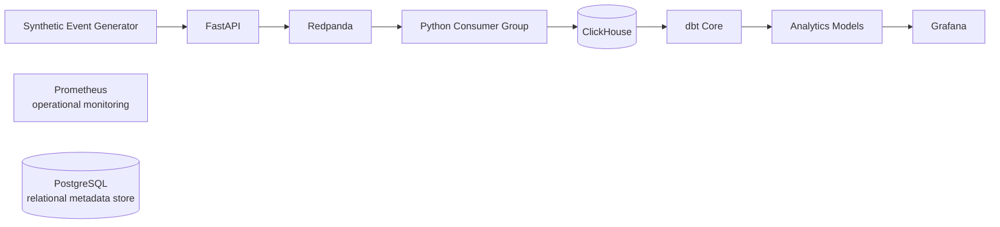
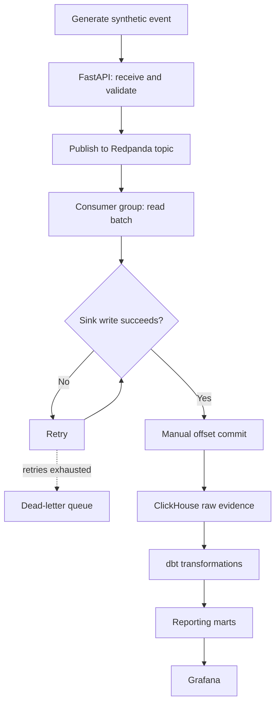
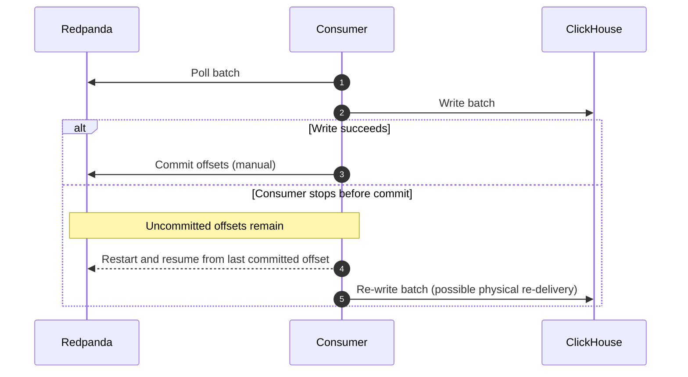
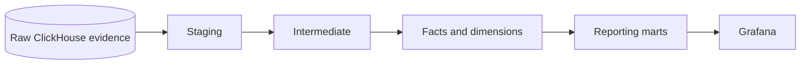

# PulseStream

**Distributed Event Analytics & Reliability Platform**

> **Scope and status.** PulseStream is an engineering MVP and a reproducible local experiment. It makes no claim of production high availability or exactly-once delivery. Items marked **[NEEDS INPUT]** are not yet verified against the repository, and no performance figure, test result or experiment outcome appears here without evidence.

**Status labels used in this document**

| Label | Meaning |
|---|---|
| Implemented | Confirmed in the implementation status record |
| Planned | Scoped but not complete |
| Executed | Experiment run, with evidence in `docs/` |
| Target | Intended goal; not a measured result |
| Measured | Result backed by a benchmark report |

---

## Contents

1. [Title and overview](#pulsestream)
2. [Executive summary](#2-executive-summary)
3. [Project at a glance](#3-project-at-a-glance)
4. [Research framing](#4-research-framing)
5. [System architecture](#5-system-architecture)
6. [End-to-end event lifecycle](#6-end-to-end-event-lifecycle)
7. [Event contract](#7-event-contract)
8. [Streaming and processing architecture](#8-streaming-and-processing-architecture)
9. [Delivery semantics and reliability](#9-delivery-semantics-and-reliability)
10. [Data storage and modeling](#10-data-storage-and-modeling)
11. [Analytics architecture and dbt](#11-analytics-architecture-and-dbt)
12. [Data quality and reconciliation](#12-data-quality-and-reconciliation)
13. [Observability and dashboards](#13-observability-and-dashboards)
14. [Failure-injection experiments](#14-failure-injection-experiments)
15. [Benchmark methodology](#15-benchmark-methodology)
16. [Technology decisions](#16-technology-decisions)
17. [Repository structure](#17-repository-structure)
18. [Local setup](#18-local-setup)
19. [API documentation](#19-api-documentation)
20. [Event generation](#20-event-generation)
21. [Testing and CI/CD](#21-testing-and-cicd)
22. [Operational runbook](#22-operational-runbook)
23. [Security and privacy](#23-security-and-privacy)
24. [Limitations and scope boundaries](#24-limitations-and-scope-boundaries)
25. [Implementation roadmap](#25-implementation-roadmap)
26. [Documentation map](#26-documentation-map)
27. [Interview discussion guide](#27-interview-discussion-guide)
28. [References](#28-references)

---

## 2. Executive summary

**PulseStream** is a portfolio-grade engineering project demonstrating distributed event ingestion, streaming reliability, analytics engineering, data quality and observability.

Events flow from a synthetic generator through FastAPI into Redpanda, are consumed by a Python consumer group, stored in ClickHouse, and transformed by dbt Core into analytics models visualized in Grafana. Prometheus provides operational monitoring, and PostgreSQL is a separate relational metadata store.

**[NEEDS INPUT]** One or two sentences stating the project's central engineering question or thesis, taken from the PRD.

## 3. Project at a glance

| Dimension | Design |
|---|---|
| Event source | Synthetic event generator |
| Ingestion API | FastAPI |
| Streaming platform | Redpanda |
| Processing | Python consumer group |
| Analytical store | ClickHouse |
| Transformation | dbt Core |
| Dashboards | Grafana |
| Operational monitoring | Prometheus |
| Relational metadata store | PostgreSQL |
| Delivery posture | At-least-once design intent **[NEEDS INPUT: confirm in TAD]** |
| Maturity | Engineering MVP; reproducible local experiment |

## 4. Research framing

**[NEEDS INPUT]** Research question(s), hypotheses and success criteria from the PRD. Left empty rather than inferred.

## 5. System architecture

Primary pipeline, with Prometheus as operational monitoring and PostgreSQL as a separate metadata store.

### 5.1 Component ownership and boundaries

| Component | Owns | Does not own |
|---|---|---|
| Synthetic Event Generator | **[NEEDS INPUT]** | **[NEEDS INPUT]** |
| FastAPI | **[NEEDS INPUT]** | **[NEEDS INPUT]** |
| Redpanda | **[NEEDS INPUT]** | **[NEEDS INPUT]** |
| Python Consumer Group | **[NEEDS INPUT]** | **[NEEDS INPUT]** |
| ClickHouse | **[NEEDS INPUT]** | **[NEEDS INPUT]** |
| dbt Core | **[NEEDS INPUT]** | **[NEEDS INPUT]** |
| Grafana | **[NEEDS INPUT]** | **[NEEDS INPUT]** |
| Prometheus | **[NEEDS INPUT]** (scrape targets to be confirmed) | **[NEEDS INPUT]** |
| PostgreSQL | **[NEEDS INPUT]** (what metadata it stores) | **[NEEDS INPUT]** |

## 6. End-to-end event lifecycle

> **Conceptual.** This diagram shows the lifecycle implied by the stated design topics (manual offset commits, retries, DLQ). **[NEEDS INPUT]** Confirm commit ordering, retry policy and DLQ trigger against the TAD before treating it as implemented behavior.

## 7. Event contract

**[NEEDS INPUT]** Fields, types, required/optional, event identity key, schema versioning. To be taken from the event contract document; none are listed here.

## 8. Streaming and processing architecture

| Topic | Design | Status |
|---|---|---|
| Partition key | **[NEEDS INPUT]** | **[NEEDS INPUT]** |
| Consumer group | Python consumer group | **[NEEDS INPUT]** |
| Offset commits | Manual | **[NEEDS INPUT]** |
| Batching | **[NEEDS INPUT]** | **[NEEDS INPUT]** |
| Retry mechanism | **[NEEDS INPUT]** | **[NEEDS INPUT]** |
| Dead-letter queue | **[NEEDS INPUT]** | **[NEEDS INPUT]** |

## 9. Delivery semantics and reliability

**Posture:** at-least-once design intent. PulseStream does not claim exactly-once delivery.

### 9.1 Physical sink retries versus logical duplicate events

These are kept distinct throughout the project:

| Concept | Definition | Handling |
|---|---|---|
| Physical sink retry | **[NEEDS INPUT: exact wording from TAD]** | **[NEEDS INPUT]** |
| Logical duplicate event | **[NEEDS INPUT: exact wording from TAD]** | **[NEEDS INPUT]** |

### 9.2 Failure recovery

> **Conceptual.** Illustrates what manual commits imply under an at-least-once design. **[NEEDS INPUT]** Confirm against the TAD.

### 9.3 Reliability topics

| Topic | Design | Evidence |
|---|---|---|
| Consumer lag | **[NEEDS INPUT]** | **[NEEDS INPUT]** |
| Recovery behavior | **[NEEDS INPUT]** | **[NEEDS INPUT]** |
| Late-arriving events and correction horizon | **[NEEDS INPUT]** (horizon value) | **[NEEDS INPUT]** |

## 10. Data storage and modeling

| Store | Role | Contents |
|---|---|---|
| Redpanda | Event log | **[NEEDS INPUT]** |
| ClickHouse | Raw event evidence and analytical output | **[NEEDS INPUT]** (databases, tables, engines) |
| PostgreSQL | Relational metadata store | **[NEEDS INPUT]** |

## 11. Analytics architecture and dbt

*Layer names only. No model names are shown because they have not been verified against `dbt_project.yml` and the `models/` directory.*

### 11.1 Layer responsibilities

| Layer | Responsibility |
|---|---|
| Staging | **[NEEDS INPUT]** |
| Intermediate | **[NEEDS INPUT]** (deduplication rules) |
| Facts and dimensions | **[NEEDS INPUT]** (fact grains, dimension relationships) |
| Reporting marts | **[NEEDS INPUT]** (metric definitions) |

### 11.2 Model inventory

**[NEEDS INPUT]** Table of real model names, layer, grain, key and tests, generated from the dbt project.

## 12. Data quality and reconciliation

| Control | Description | Status |
|---|---|---|
| dbt tests | **[NEEDS INPUT]** | **[NEEDS INPUT]** |
| Deduplication rules | **[NEEDS INPUT]** | **[NEEDS INPUT]** |
| Reconciliation | **[NEEDS INPUT]** (what is compared with what) | **[NEEDS INPUT]** |
| Lineage | **[NEEDS INPUT]** (`dbt docs`) | **[NEEDS INPUT]** |

## 13. Observability and dashboards

| Area | Description | Status |
|---|---|---|
| Prometheus metrics | **[NEEDS INPUT]** | **[NEEDS INPUT]** |
| Grafana dashboards | **[NEEDS INPUT]** (screenshots only once real) | **[NEEDS INPUT]** |
| Consumer lag visibility | **[NEEDS INPUT]** | **[NEEDS INPUT]** |

## 14. Failure-injection experiments

Each experiment is labeled **Planned** or **Executed**. Executed experiments must link to evidence under `docs/`.

| # | Experiment | Controlled input | Expected behavior | Evidence collected | Recovery validation | Status |
|---|---|---|---|---|---|---|
| 1 | Consumer interruption | **[NEEDS INPUT]** | **[NEEDS INPUT]** | **[NEEDS INPUT]** | **[NEEDS INPUT]** | **[NEEDS INPUT]** |
| 2 | Consumer recovery | **[NEEDS INPUT]** | **[NEEDS INPUT]** | **[NEEDS INPUT]** | **[NEEDS INPUT]** | **[NEEDS INPUT]** |
| 3 | ClickHouse outage | **[NEEDS INPUT]** | **[NEEDS INPUT]** | **[NEEDS INPUT]** | **[NEEDS INPUT]** | **[NEEDS INPUT]** |
| 4 | ClickHouse recovery | **[NEEDS INPUT]** | **[NEEDS INPUT]** | **[NEEDS INPUT]** | **[NEEDS INPUT]** | **[NEEDS INPUT]** |
| 5 | Burst load | **[NEEDS INPUT]** | **[NEEDS INPUT]** | **[NEEDS INPUT]** | **[NEEDS INPUT]** | **[NEEDS INPUT]** |
| 6 | Late events inside the correction horizon | **[NEEDS INPUT]** | **[NEEDS INPUT]** | **[NEEDS INPUT]** | **[NEEDS INPUT]** | **[NEEDS INPUT]** |
| 7 | Late events outside the correction horizon | **[NEEDS INPUT]** | **[NEEDS INPUT]** | **[NEEDS INPUT]** | **[NEEDS INPUT]** | **[NEEDS INPUT]** |
| 8 | DLQ archiver interruption | **[NEEDS INPUT]** | **[NEEDS INPUT]** | **[NEEDS INPUT]** | **[NEEDS INPUT]** | **[NEEDS INPUT]** |

## 15. Benchmark methodology

### 15.1 Setup

| Item | Value |
|---|---|
| Workload profile | **[NEEDS INPUT]** |
| Event rate | **[NEEDS INPUT]** |
| Event volume | **[NEEDS INPUT]** |
| Test environment (hardware, OS, versions) | **[NEEDS INPUT]** |

### 15.2 Results

| Metric | Target | Measured | Status |
|---|---|---|---|
| Throughput | **[NEEDS INPUT]** | No result recorded | Pending |
| Processing delay | **[NEEDS INPUT]** | No result recorded | Pending |
| p95 visibility delay | **[NEEDS INPUT]** | No result recorded | Pending |
| Consumer lag | **[NEEDS INPUT]** | No result recorded | Pending |
| Catch-up time | **[NEEDS INPUT]** | No result recorded | Pending |
| Reconciliation | **[NEEDS INPUT]** | No result recorded | Pending |

Replace "No result recorded" only with figures from a benchmark report, and link that report.

## 16. Technology decisions

| Technology | Role | Rationale | Alternatives considered |
|---|---|---|---|
| FastAPI | Ingestion API | **[NEEDS INPUT]** | **[NEEDS INPUT]** |
| Redpanda | Streaming platform | **[NEEDS INPUT]** | **[NEEDS INPUT]** |
| ClickHouse | Analytical store | **[NEEDS INPUT]** | **[NEEDS INPUT]** |
| dbt Core | Transformation | **[NEEDS INPUT]** | **[NEEDS INPUT]** |
| Grafana | Dashboards | **[NEEDS INPUT]** | **[NEEDS INPUT]** |
| Prometheus | Monitoring | **[NEEDS INPUT]** | **[NEEDS INPUT]** |
| PostgreSQL | Metadata store | **[NEEDS INPUT]** | **[NEEDS INPUT]** |

## 17. Repository structure

**[NEEDS INPUT]** Directory tree generated from the repository.

## 18. Local setup

**[NEEDS INPUT]** Prerequisites, start/stop commands, ports and verification steps. Only commands that have been run should appear here.

## 19. API documentation

**[NEEDS INPUT]** Endpoints, request/response examples and error behavior, from the OpenAPI spec or routers.

## 20. Event generation

**[NEEDS INPUT]** Generator modes, determinism/seeding, rate controls, late-event and duplicate injection options.

## 21. Testing and CI/CD

**[NEEDS INPUT]** Test suites, dbt build/test, workflows. Include only tests that exist, and report results only if executed.

## 22. Operational runbook

**[NEEDS INPUT]** Procedures for consumer restart, lag investigation, ClickHouse outage, DLQ inspection and replay.

## 23. Security and privacy

**[NEEDS INPUT]** Data handling and access boundaries. Known: events are synthetic **[NEEDS INPUT: confirm]**.

## 24. Limitations and scope boundaries

- Engineering MVP and reproducible local experiment, not a production deployment.
- No claim of production high availability.
- No claim of exactly-once delivery.
- **[NEEDS INPUT]** Further scope exclusions from the PRD.

## 25. Implementation roadmap

| Milestone | Status |
|---|---|
| **[NEEDS INPUT]** | **[NEEDS INPUT]** |

## 26. Documentation map

**[NEEDS INPUT]** Links to the PRD, TAD, implementation status, event contract, metric catalog and benchmark reports. Add each link only after confirming the file exists.

## 27. Interview discussion guide

| Topic | Question a reviewer might ask | Where to look |
|---|---|---|
| Delivery semantics | Why at-least-once rather than exactly-once? | [Section 9](#9-delivery-semantics-and-reliability) |
| Duplicates | How do physical sink retries differ from logical duplicates? | [Section 9.1](#91-physical-sink-retries-versus-logical-duplicate-events) |
| Analytics | How are facts deduplicated and reconciled? | [Sections 11](#11-analytics-architecture-and-dbt) and [12](#12-data-quality-and-reconciliation) |
| Failure handling | What happens when ClickHouse is down? | [Section 14](#14-failure-injection-experiments) |

**[NEEDS INPUT]** Answers, once the underlying design is confirmed.

## 28. References

**[NEEDS INPUT]**
